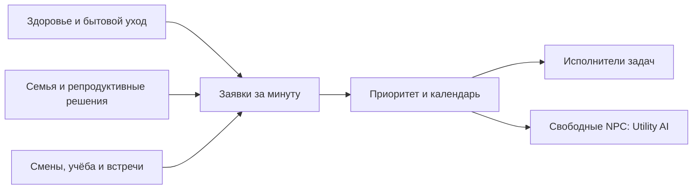

# Общее планирование обязательств NPC

28 октября 2026 · Godot 4.7.2. Собственная реализация EroInc, подключённая
к автономному runtime и основной игре. Текущая основная схема проекта — 9.

После обновления систем за игровую минуту планировщик выбирает совместимые
заявки, запускает победившие задачи и передаёт свободных NPC обычному Utility AI.
Приоритет определяется общими правилами, а не порядком регистрации сервисов.

## Календарь и дорога

`npc_calendar.gd` строит календарь обязательных смен, занятий и назначенных
встреч на следующие 24 часа. Учитываются дни недели, условия, переход через
полночь и полуоткрытые интервалы. Проверка задачи включает дорогу к ней,
её длительность и путь от места завершения к следующему обязательству.
Для будущего маршрута доступность мест оценивается в будущем времени;
прогноз не передвигает часы мира и не расходует RNG.

Выезд на работу учитывает существующий 15-минутный шаг решений NPC.
Назначенные встречи проверяются каждую минуту. Поездка сохраняет исходное
место, время прибытия и владельца брони. Локация меняется при прибытии,
результат встречи — при фактическом присутствии обоих участников.
Невозможность NPC добраться не снижает доверие к игроку.

## Приоритеты и исполнение

| Приоритет | Обязательство |
| --- | --- |
| 100 | Срочная помощь при актуальном состоянии здоровья |
| 85 | Репродуктивное решение или действие с ограниченным сроком |
| 80 | Назначенная встреча |
| 75 | Дородовой уход |
| 70 | Выезд на обязательную смену или учёбу |
| 65 | Уход за ребёнком и материнский бытовой уход |
| 60 | Обычный уход за взрослым здоровьем |
| 55 | Покупки, профилактика, документы и семейные поездки |
| 40 | Частная встреча или инициатива отношений |

Числа определяют игровой порядок выбора. Обязательные интервалы календаря
ограничивают обычные задачи независимо от числа приоритета. Начатые задачи
сохраняют бронь; срочная помощь может освободить известных владельцев.
Неизвестная сюжетная бронь остаётся под управлением сюжета.

Заявка сама по себе не расходует ресурсы и не выдаёт результат. Исполнители
проверяют деньги и расходники при запуске и завершении. Одному NPC назначается
один победитель; парная заявка требует свободных участников. Равные приоритеты
разрешаются стабильно по владельцу, персонажу и виду задачи.

Срочность согласованно прерывает известные бытовые, семейные, репродуктивные
и частные задачи. Незавершённое действие не получает награду. Медицинская
отмена встречи не создаёт обиду на игрока. Ночной срочный маршрут допускает
прибытие в клинику вне обычных часов, сохраняя остальные проверки пути.

## Состояние и проверка

Очередь заявок очищается после шага, отката команды и восстановления состояния.
Долговечные задачи остаются в существующих разделах, а поездка к назначенной
встрече — в её записи. Загрузка проверяет ссылки, времена, положение и отсутствие
нескольких владельцев одного NPC. Преобразования старых сохранений не добавлялись.

`npc_planner.inspect` возвращает календарь и активное обязательство; инспекция
`npc_agency` также включает эти сведения. Принятая заявка сохраняет в
`mind.decision` исполнителя, приоритет, место и срок.

Проверки и хеши: [verification/npc-planner-2026-10-28/report.json](verification/npc-planner-2026-10-28/report.json).
Сценарии проверяют порядок заявок, отсутствие расходов проигравшей задачи,
запас на дорогу, выезд к открытию работы, встречи и их загрузку в пути,
ночную срочность, отмены, повреждённые брони и откат очереди. Основная игра
проверяет реальный городской маршрут и семейный интерфейс со снимком.

При сравнении действий один NPC повторно использует прогноз календаря и
маршруты в пределах одного решения. Данные этого расчёта освобождаются после
решения. Профилирование `profile_npc_planner.gd` на 100 NPC / 300 запросах:
локальный замер оценки вариантов снизился с 1,66 до 0,67 секунды. Это
headless-замер CPU, зависящий от нагрузки системы, а не оценка частоты кадров.
Отдельная проверка подтверждает отсутствие изменений мира и RNG от прогноза.

Следующие направления — передача домашней нагрузки, покупки и сопровождение
другого человека, персональный медицинский календарь и длительное планирование
намерений. Прогноз использует известные условия мира; изменение погоды,
ресурсов или доступности может потребовать нового решения.
