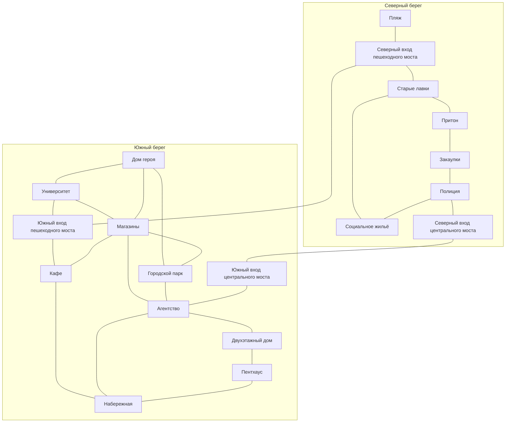

# EroInc — город, в котором свобода имеет адрес

Дизайн-концепт мира и локаций · 28 октября 2026 · версия для обсуждения.

**Предложение:** превратить существующий речной город в Вейр — университетский город Элизии, который обещает каждому право быть собой, но распределяет безопасность, признание и возможность уйти через деньги, документы и личные связи. Здесь можно построить хорошую жизнь. Именно поэтому её потеря, компромиссы ради неё и соблазн устроиться за чужой счёт имеют вес.

Вейр — новое рабочее название, не найденное в сценарии. Новые учреждения, жители, районные названия и квесты ниже — предложения автора этого концепта. Канонические опоры перечислены отдельно. Документ развивает 15 существующих локаций и предлагает 6 новых: всего 21 точку одного города. Код, сценарные таймлайны, карту и сохранения не меняет.

**Граница текущего этапа, уточнённая владельцем:** разрабатываем один город. Перемещение между двумя городами — последующий самостоятельный этап. Сейчас не проектируем второй игровой город, транспорт между городами или связанные с ним обязательные задания. Страны присутствуют через биографии, товары, переписку и общественные конфликты внутри Вейра.

**Расширение объёма по уточнению владельца:** разрешены дополнительные локации, необходимые для работы и развития персонажа. Исходные 15 точек — основа, а не предел. Отдельная новая точка должна давать собственный повторяемый игровой цикл, окружение и социальные связи; обычный прилавок или кабинет остаётся внутренней зоной.

Для первого чтения: разделы 2–5 описывают характер и устройство города; раздел 6 содержит все 21 карточку и направления профессионального роста; разделы 8–10 показывают игровой цикл и задания; разделы 14–15 отделяют предложения от реализации и спорного канона.

## 1. На что опирается концепт

### Подтверждённые опоры

| Опора | Источник | Следствие для дизайна |
| --- | --- | --- |
| Праксия утверждает превосходство людей; Феларион — превосходство «чистокровных» антро; Элизия сравнительно свободна, но напряжение сохраняется | Google Doc, «Пояснительная бригада» | Конфликты пересекают видовые границы. Элизия не должна оказаться точной копией Праксии с другой вывеской |
| В Элизии 2–3 крупных города, передовые лаборатории генетики, биоэтики и социальных исследований | Там же | Университет влияет на городской рынок труда, миграцию и представления о нормальности |
| Официальное название университета — Институт эволюционной геномики имени Карла Линнея | Там же; `STORY_LOCKS.md` | Образование и исследования — часть устройства мира, а не случайный фон для школьных сцен |
| В прологе толпа требует расправы; голос `god?` ставит вопрос об ответственности героя | Google Doc, начало «Пролога»; локальные сцены склада и перезапуска | Город должен объяснять, как разные люди способны прийти к совместной жестокости. Реплики голоса не доказывают вину героя и не устанавливают объективную мораль мира |
| Свидетели травли Оливера боятся мести и не верят в действенность наказания | Google Doc, начало «Проблемы Оливера» | Между правилом и защитой есть конкретный разрыв: сообщение о насилии само по себе ещё не делает свидетеля безопасным |
| Участники косплейного клуба спорят о различии между костюмом и неснимаемой внешностью | Google Doc, «Клуб косплея» | Влечение, любопытство, солидарность, присвоение чужого опыта и коммерциализация могут соседствовать |
| Нынешний дом героя одноэтажный, с огороженным двором; университет рядом | `STORY_LOCKS.md`; начало «Акта 1» | Сохраняем домашний масштаб и привычную дорогу; дом не становится общежитием или высоткой |
| Университет: красный кирпич, центральное крыло 6 этажей, боковые по 3; большой парк перед входом; аудитория 213 в левом крыле на втором этаже | `STORY_LOCKS.md`; авторские пояснения | Уточняем внутренние функции, не меняем установленный силуэт и маршрут |
| Южный берег больше северного; сейчас 15 точек и два моста | `city-river-v2.json` | Сохраняем основу; по новому поручению добавляем необходимые места работы и развития, сохраняя два моста |
| Детский флешбэк связан с Праксией; настоящее героя — с Элизией | Локальные сцены 05–08 | Арка мира, морская набережная и детское жильё не переносятся автоматически в нынешний речной город |

Прочитаны доступные фрагменты оригинала в обычном интерфейсе Google Docs и локальная адаптация. Это не заявление о построчной проверке всех веток документа. Полный список источников и открытых противоречий — в конце.

### Главная авторская позиция

Мрачность появляется там, где нормальная жизнь и причинение вреда поддерживают друг друга. Сотрудник банка может искренне защищать своего соседа и зарабатывать на выселениях незнакомцев. Исследователь помогает пациентам, но принимает несправедливое распределение доступа. Человек, переживший травлю, способен поддержать новую травлю, когда впервые оказывается среди сильных.

Это не уравнивает ответственность пострадавшего и агрессора. У конкретного действия есть инициатор, возможности отказа, ущерб и выгодополучатель. Сложность мира должна добавлять причины и варианты действий, а не превращать любое насилие в «у каждого своя правда».

## 2. Обещание игроку и характер мира

**Игрок проживает самостоятельную взрослую жизнь и постепенно понимает, какую цену платит за принадлежность к городу — сам и через других.** Учёба, работа, отношения, дом и телесная идентичность образуют одну историю. Хорошая подработка может стать первым знакомством с будущим покровителем; соседская помощь — устойчивой альтернативой его власти.

Пять опор тона:

1. **Привлекательная повседневность.** Кафе действительно вкусно кормит; фестиваль действительно радует; дом становится любимым. Научный прогресс приносит настоящую пользу.
2. **Неравная свобода.** Два совершеннолетних жителя формально могут принять одинаковое решение, но одному оно стоит неудобства, а другому жилья, карьеры или поддержки семьи.
3. **Повседневное соучастие.** Большая несправедливость держится на мелких удобствах, привычках и выгодных исключениях. У неё нет единственного выключателя.
4. **Ограниченная, ощутимая субъектность.** Можно защитить человека, изменить процедуру, удержать помещение, испортить влиятельному лицу план. Нельзя одной речью исправить страну.
5. **Личная ответственность без всеведущего суда.** Мир реагирует через свидетелей, документы, поступки и отношения. Шкала «добро/зло» не подменяет эти связи.

### Что здесь означает трансгрессия

Трансгрессия проверяет границы собственности, нормальности, близости и права распоряжаться чужой жизнью. Тело может одновременно быть человеком, объектом исследования, семейным символом и продаваемым образом. Поступок, который окружение считает неприличным, может быть честным и добровольным; общественно одобряемый договор — способом зависимости.

Взрослая сексуальность входит в культуру города через отношения, ночные пространства, самоопределение, рекламу и экономику внимания. Нестандартные добровольные отношения не служат автоматическим признаком порока. Принуждение, вторжение в частную жизнь и эксплуатация — самостоятельные конфликты с последствиями, а не эстетическое украшение. Интимность не выдаётся как награда за спасение или накопление доверия.

Детское воспоминание остаётся самостоятельной неэротической частью биографии. Настоящие взрослые отношения не меняют смысл и возраст участников прошлого.

### Современность без обязательного киберпанка

Предлагается близкий к современности бытовой уклад с неравномерно продвинутой биотехнологией: мессенджеры, банковские приложения, платформенная занятость, записи камер, цифровые пропуска, аренда, частные исследования, городские медиа. Дешёвые автобусы, старые трубы и бумажные справки сосуществуют с нейропротезированием. Точный год пока не фиксируется.

Никакого всезнающего городского рейтинга. Разные учреждения хранят разные сведения и делают разные выводы. Закрытый клуб не знает о банковском долге без источника; слух из студенческой группы не превращается автоматически в полицейский факт.

## 3. Вейр и окружающий мир

### Зачем существует этот город

Вейр — один из крупных городов маленькой Элизии. Рабочая специализация: международное образование, прикладные биотехнологии и обслуживание приезжающих специалистов. Это позволяет связать уже существующие университет, торговлю, дорогое жильё и старый северный берег.

Предлагаемая история развития, без спорных дат:

- Первоначально — речной торговый узел с мастерскими и складами на северном берегу.
- Рост образования и исследований переносит престижные рабочие места на юг. Старые мастерские становятся поставщиками, ремонтниками и дешёвой логистикой новой экономики.
- Приток студентов, пациентов, работников и капитала поднимает аренду. Город продаёт образ совместной жизни, а стоимость самой этой жизни растёт.
- Сейчас частный проект обновления северного берега обещает ремонт и рабочие места. Кто сможет жить здесь после обновления — основной открытый городской конфликт первой большой арки.

Это предложение о социальной истории, не установленная биография нынешней карты. Склад пролога может быть связан со старой логистикой, но его адрес и реальная природа пока остаются тайной.

### Три страны в повседневных разговорах

| Страна | Что даёт Вейру по предлагаемой модели | Как влияние встречается в игре | Внутреннее различие |
| --- | --- | --- | --- |
| Праксия | Капитал, оборудование, технологические контракты, студентов | Стипендия от зарубежного фонда; семья просит «не портить будущее»; наниматель ценит диплом, но не принимает партнёра сотрудника | Идеология превосходства не означает, что каждый человек её поддерживает. Приезжают также несогласные и смешанные семьи |
| Феларион | Специалистов, общинные сети, рынок сотрудничества | Культурный центр во временном помещении; помощь землякам; спор о том, кто имеет право представлять общину | Сторонники чистоты происхождения конфликтуют с теми, кому нужна широкая солидарность |
| Элизия | Защиту законом, возможность учиться вместе, относительную свободу выбора | Жалоба иногда реально помогает; независимый специалист может возразить инвестору; отношения не обязательно скрывать | Право работает неодинаково, а сохранение привлекательного образа страны само становится экономическим интересом |

Государственная доктрина, позиция диаспоры и убеждения отдельного NPC — разные вещи. Морфология не назначает человеку характер, гражданство, профессию или мораль.

### Пять ресурсов, которые действительно делят жители

| Ресурс | Кто распределяет | Повседневная цена | Драматический вопрос |
| --- | --- | --- | --- |
| Жильё | Владельцы, агентство, социальная служба | Аренда, залог, поручитель, зависимость от принимающего | Сколько чужого контроля допустимо за закрывающуюся дверь? |
| Возможности | Университет, работодатели, спонсоры | Время, рекомендации, неоплаченная подготовка | Чьё имя исчезает из результата, который делает тебя успешным? |
| Забота | Клиники, семьи, друзья, соседские сети | Очередь, деньги, труд близких | Кто заботится о человеке, которого никто не считает выгодным? |
| Правдоподобие | Документы, свидетели, медиа, полиция | Публичность, риск для источника, доступ к записи | Кому поверят раньше, чем проверят? |
| Возможность отказаться | Собственные деньги, альтернативное жильё, независимые связи | Потеря удобства или статуса | Есть ли у человека реальный выход из сделки? |

### Как здесь устроена обычная жизнь

**Городская власть.** Предлагается выборный городской совет и администрация, которая распределяет контракты на содержание улиц, размещение и мероприятия. В первой версии они встречаются через выездной приём, объявления и конкретных сотрудников. Новая ратуша на карте не нужна. Институт влиятелен, но не управляет всей Элизией и не заменяет государство.

**Закон и обычай.** Рабочая модель Элизии — равный правовой статус совершеннолетних жителей независимо от происхождения; запрет насилия, угроз и дискриминационных отказов. Это новое предложение о праве вымышленного государства, а не цитата сценария. Проблемы возникают в доказательствах, исключениях, исполнении и неформальном давлении. Если сама Элизия законодательно запрещает смешанные отношения, её отличие от соседей исчезает — такой запрет здесь не предлагается.

**Деньги и труд.** Валюту и цены берём из действующих игровых правил; придумывать второй денежный баланс не требуется. Существуют постоянная занятость, смены, частные заказы, гранты, семейная помощь и неформальная работа. Удобство обеспеченного горожанина создают конкретные люди, которых можно встретить за пределами смены. Не все долги криминальны, не всякая работа унизительна.

**Здоровье и исследования.** Обычная помощь отделена от участия в исследовании: предлагается самостоятельная городская клиника. Институт занимается исследовательскими задачами, а не любой болезнью города. Пациент, доброволец и сотрудник лаборатории — разные роли. Генные технологии не решают любую проблему мгновенно и не доказывают правильность общественной иерархии.

**Культура.** Город живёт началом учебного года, студенческим фестивалем, субботним рынком старого берега и осенними речными огнями. Названия событий рабочие. У жителей есть любимые песни, блюда, местные шутки и раздражающие туристические привычки. Смешанная кухня и мастерские показывают культурный обмен без обязательной лекции о толерантности. Крупное мероприятие может состояться хорошо и не оказаться ловушкой.

**Частность.** Одни семьи требуют публично соответствовать ожиданиям, другие принимают близких. Кто-то ищет анонимность, кто-то хочет быть заметным. Телесная модификация, имя, одежда и добровольные отношения дают самостоятельные желания, а не только сюжетные проблемы. Соседские сплетни, родительское давление и коммерческая съёмка действуют по разным правилам.

**Вера и объяснения мира.** В городе могут сосуществовать религиозные общины, светская биоэтика и бытовые представления о судьбе. Пока не вводим единый пантеон или церковь, объясняющую `god?`. Знакомый персонаж вправе предложить собственную интерпретацию пережитого героем; это характеристика человека, не ответ автора.

### Улица, ночь и скрытые практики

Город должен допускать жёсткие, опасные и соблазнительные истории, а не сводиться к разбирательствам с заявлениями. Предлагаются несколько практик, существующих локально и не управляемых одной организацией:

- **Покровительство с личными условиями.** Дорогие приёмы смешивают карьеру, влечение, дружбу и доступ к нужным людям. Добровольный роман может быть счастливым; давление появляется, когда отказ используют против работы или жилья. Сцена должна позволять различить эти случаи.
- **Ночные ставки и закрытые поединки.** Один из посредников старого берега зарабатывает на жажде признания и быстрых денег. Участники могут хотеть риска сами; конфликт возникает вокруг обмана, давления и возможности остановиться. Это предлагаемая сюжетная среда, не требование новой боевой подсистемы.
- **Рынок чужой биографии.** Компрометирующие изображения, вырванные из контекста сведения и истории отношений превращают человека в товар для аудитории. Важны утрата контроля, предательство знакомого и последствия для связи; способы реальной кражи данных документ не разрабатывает.
- **Закрытые услуги для обеспеченных.** То, что на севере объявляется позором и поводом для проверки, в дорогой квартире переименовывают в частную договорённость. Само желание не получает моральной оценки по адресу; различается способность участника диктовать условия и скрывать последствия.
- **Насилие как групповое развлечение.** Некоторым агрессорам приятно доминировать, унижать и наблюдать чужой страх. Им не обязательна оправдывающая травматическая биография. Групповое одобрение и ожидание безнаказанности объясняют поведение, не извиняя его.

Игровые сцены здесь могут строиться на наблюдении, ложном первом впечатлении, выборе союзника, своевременном уходе, защите другого, столкновении и бегстве. Проверка силы способна выиграть время, но не решить чужую жизнь; красноречие не заставляет любого человека подчиниться. Мир должен давать ситуации, где безопаснее уйти, где разумно позвать помощь и где решительное вмешательство действительно помогает.

Жёсткость требует конкретного последствия: потерянной работы, разорванной связи, травмы, страха возвращаться, уголовного дела или изменения привычного маршрута. После угрозы персонаж не возвращается к нейтральному флирту на следующем клике. В то же время бар, праздник, свидание и частная близость не обязаны неизбежно кончаться наказанием.

## 4. География и районы

Существующая карта v2 визуально просмотрена. Её сильная сторона — привлекательный ночной речной город с двумя понятными переправами. Для нового концепта сохраняются расположение зданий и силуэты. Социальное содержание добавляется в уличные сцены и интерьеры.

| Рабочий район | Существующие точки | Обещание района | Противоречие |
| --- | --- | --- | --- |
| Линнеевский квартал, юго-запад | Дом героя, университет | Можно начать новую жизнь | Формальное равенство вступает в конфликт с неравными ресурсами и покровительством |
| Южный пассаж, центр юга | Магазины, кафе, агентство | Все нужные услуги рядом | Почти любое удобство требует чьей-то дешёвой работы |
| Сады и речной фасад, юг/юго-восток | Парк, набережная | Город принадлежит всем | Общедоступное пространство постепенно превращается в арендуемую витрину |
| Террасы, восток юга | Двухэтажный дом, пентхаус | Независимость и успех | Вход в защищённую среду создаёт обязательства перед её участниками |
| Старый берег, запад/центр севера | Пляж, притон, лавки, закаулки | Можно жить иначе и дешевле | Взаимопомощь соседствует с зависимостью от неформальных хозяев |
| Северный узел, восток севера | Полиция, социальное жильё | Помощь и порядок | Уязвимость становится предметом учёта; защитник может одновременно контролировать |

Север — не территория одной расы или сплошная зона преступности. Там живут мастера, сотрудники института, семьи и люди со своей гордостью. Южный берег тоже содержит бедность, тесноту и насилие. Разница — в заметности проблем и возможности от них отгородиться.

### Река и мосты как игровая структура

Пешеходный мост связывает университетскую жизнь со старым берегом: пары, дешёвый ремонт, прогулки и вечерние встречи. Центральный — жильё, документы, официальные услуги и городское движение. Оба остаются обычными общественными переправами; границы государств посреди города нет.

Схема показывает связи действующего каталога, а не расстояния или художественную планировку. Время пути здесь не переопределено: прямой переход дом → университет занимает 14 минут; через южные магазины получается 4 + 10 = 14. Ограничение «10–15 минут» сохраняется; будущая детализация должна проверять также альтернативные пути.

Клиника, спортивный центр, грузовой двор, кооперативные мастерские, дом культуры и деловой центр предложены как отдельные точки. Их расположение и связи описаны после основных карточек. Читальня, клубные комнаты, банковский приём и городская консультация остаются внутренними помещениями. Граф выше показывает только существующую карту, без ещё не интегрированных расширений.

## 5. Группы влияния

У групп есть полезная работа, внутренние разногласия и ограниченные ресурсы. Они не состоят целиком из злодеев или спасителей. Рабочие названия можно менять без изменения устройства мира.

| Группа | Полезная функция и реальная цель | На что способна давить | Внутренний конфликт |
| --- | --- | --- | --- |
| Институт Линнея | Учить, исследовать, лечить; сохранить научную независимость | Рекомендации, лабораторные места, доступ к оборудованию | Преподаватели, администрация, исследователи и комиссия по этике по-разному понимают допустимый риск |
| Консорциум «Общий берег» — новый | Ремонтировать кварталы и получать доход от новой недвижимости | Аренда, подряд, рекламные бюджеты, спонсорство | Архитектор хочет сохранить жильцов; финансовый директор считает их препятствием; мелкий инвестор сам зависит от договора |
| Городская служба размещения — новая функция при существующем агентстве | Не оставлять людей без крыши и уложиться в ограниченный фонд | Очередь, направление, временное помещение | Социальные работники против административных показателей; не каждый отказ является коррупцией |
| Сеть «Соседский стол» — новая | Еда, ремонт, сопровождение, обмен сменами | Доверие, доступ к местной информации, взаимные обязательства | Кто получает помощь первым и вправе ли помощники требовать политической лояльности? |
| Ночные посредники старого берега — новая сеть | Быстро найти работу, комнату, заказ или контакт | Долг, рекомендации, неформальный доступ | Часть зарабатывает на посредничестве, часть — на невозможности клиента уйти; между ними есть конфликт |
| Участок и муниципальные службы | Реальная безопасность и расследование | Процедура, официальный статус события, временные ограничения | Следователь хочет довести дело; начальство боится скандала; патрульный не хочет работать сверх смены |
| Студенческие объединения и независимые авторы | Представительство, творчество, публичный разговор | Внимание, свидетельства, выбор площадки | Популярность, защита источника и точность публикации не всегда ведут к одному решению |

Нет тайного штаба, управляющего всеми группами. Совпадающие интересы часто дают тот же эффект, что заговор, но оставляют больше точек воздействия. Один спонсор не должен владеть университетом, полицией, кафе и всеми преступниками одновременно.

## 6. Карточки 21 локации: 15 существующих и 6 новых

Все новые названия заведений и второстепенные NPC в карточках — рабочие. Каждый новый NPC здесь совершеннолетний. Возраст и полная биография устанавливаются при разработке персонажа. Описанные события и дополнительные комнаты ещё не реализованы.

### 01. Дом героя — право закрыть дверь

**Карта/runtime:** `student_home`. Юго-запад, Линнеевский квартал. Один надземный этаж, собственный двор; спальня, коридор, ванная и кухня сохраняются. Зеркало остаётся местом создания персонажа в установленной сцене.

**Ощущение.** Тихий гул холодильника, плохо срабатывающий выключатель, влажная ограда после дождя. Через забор слышно, как чужая обычная жизнь продолжается независимо от героя. Это первое место, которое игрок может сделать своим.

**Слои.** Дом даёт отдых, приватность и бытовой контроль. Возможность жить так обеспечена семейной поддержкой, упомянутой в первом акте; игрок постепенно замечает разницу с однокурсниками, которым негде побыть одним. Арендные и бытовые обязанности связывают дом с агентством и работой.

**Люди.** Сосед ремонтирует общую ограду и считает себя вправе обсуждать гостей. Мастер по электрике честно работает, но знает бытовые тайны всего квартала и не всегда понимает границы разговора.

**Ритм и действия.** Утром — сборы, приготовление еды, сообщения. Днём — ремонт и доставка по договорённости. Вечером — гости, учёба, тихая близость или одиночество. Ночью дом по умолчанию остаётся убежищем. Угроза вторжения допустима только как подготовленное сюжетное событие с понятной причиной.

**Ситуация «Одна ночь».** Взрослый знакомый просит временно переночевать, не объясняя всё сразу. Можно согласовать срок и правила; помочь найти другое место; отказать. Отказ не записывает героя злодеем. Принятие создаёт заботу и возможную бытовую нагрузку, а не право на отношения. Долгое гостевание требует отдельного решения; NPC не поселяется навсегда скрытым флагом.

**След в мире.** Свободное место на кухне, новая бытовая договорённость, изменившийся маршрут знакомого. Повторные визиты дают жизнь дома, а не только новые просьбы.

### 02. Университет — равенство, проходящее проверку практикой

**Карта:** `university`; **runtime:** `training_center`. Архитектура 6/3/3 и парк перед входом обязательны. Главный холл ведёт прямо к актовому залу; аудитория 213 — второй этаж левого крыла, ближе к концу коридора.

**Предлагаемые подзоны.** Общедоступные холл и читальня; клубные помещения; преподавательская приёмная; лаборатории по назначению. Лаборатории не нужно помещать в ту же аудиторию, где учится группа. Подвалы с единственным «страшным секретом университета» не требуются.

**Слои.** Здесь правда учат и защищают. Разрыв возникает между политикой ректора, решениями кафедр и тем, что свидетели могут позволить себе сообщить. Система рекомендаций способна обойти формально равный конкурс даже без прямого запрета по происхождению.

**Люди.** Канонические Асука, Оливер, Элли, Уриил, Мира и Лин сохраняют свои исходные связи. Новый лаборант хочет объективного конкурса, но боится потерять контракт. Новый представитель спонсора искренне финансирует исследования и ожидает удобной публичной истории.

**Ритм и действия.** Утром — ожидание занятий и доска объявлений. Днём — учёба, практика, консультации. Вечером — клубы, работа с оборудованием, почти пустые коридоры. Ночной доступ требует конкретного разрешения и не закрывает общественные маршруты по городу.

**Ситуация «Правильный участник».** Полезная оплачиваемая практика выбирает кандидатов по критериям, удобным спонсору. Герой может принять место и использовать его для дальнейшего влияния; собрать проверяемую жалобу; организовать менее престижный независимый проект. Жалоба способна выиграть без обязательной трагедии, но требует времени и защиты участников.

**След в мире.** Меняются состав команды, объявление о наборе и доступный наставник. Человек, которому помогли, может остаться неприятным или не захотеть дружить.

### 03. Южные магазины — сколько стоит выглядеть уместно

**Карта:** `south_shops`; **runtime:** `global_map`. Южный пассаж. Внутри точки: продуктовая лавка, одежда, аптека как сервисный прилавок, пункт выдачи и небольшие рабочие места.

**Ощущение.** Светлые витрины, мокрые коврики, запах выпечки и гул вентиляции. Вывески предлагают разнообразие; стандартные размеры и инвентарь всё ещё рассчитаны на ограниченный круг тел.

**Слои.** Покупки — настоящий комфорт и способ самовыражения. Индивидуальная подгонка, средства ухода и редкие расходники обходятся дороже. Это создаёт спрос для северных мастерских; местный мастер должен быть хорошим специалистом, а не автоматически мошенником.

**Люди.** Управляющая поддерживает разнообразие покупателей, но требует «универсального вида» от работников. Подгонщик одежды умеет решать реальные проблемы и устал делать это бесплатно ради красивой рекламы.

**Ритм и действия.** Утром — поставки и короткая смена. Днём — покупки, подгонка, разговоры в очереди. Вечером — возвраты и закрытие. Витрина ночью доступна для осмотра, торговые действия зависят от часов конкретного сервиса.

**Ситуация «Форма для всех».** Новая рабочая форма неудобна сотруднику с иной морфологией. Можно оплатить индивидуальную переделку; добиться общего изменения закупки; воспользоваться случаем, чтобы получить его смены. Первое решает частную проблему, второе требует доказать экономическую и практическую возможность, третье даёт доход и конкретную испорченную связь.

**След в мире.** Меняется форма на персонаже или ассортимент; переделка остаётся видимой. Игрок возвращается за покупками, работой и результатом предыдущего решения.

### 04. Кафе у реки «Третий стол» — близость в публичном месте

**ID:** `riverside_cafe`. Терраса сохраняется. Дополнительные пространства: основной зал, укрытый от дождя стол, короткий служебный проход. Отдельный приватный кабинет не предполагается.

**Ощущение.** Пар от чашек, отражения реки в стекле, шум моста. Здесь приятно без квеста: встретиться после пары, переждать дождь, закончить работу.

**Слои.** Кафе служит местом пересечения студентов, работников и представителей обеспеченного юга. Бариста видит, кто встречается с кем, но не знает содержания каждой встречи. Хозяин защищает посетителей от грубости, одновременно считая, сколько стоят долго занятые столы.

**Люди.** Бариста поддерживает постоянного посетителя, даже если тот почти ничего не покупает. Владелица хочет сохранить бизнес и не согласна превращать помощь в неоплачиваемую обязанность персонала.

**Ритм и действия.** Утро — кофе навынос. День — работа и занятия. Вечер — свидания и переговоры. Дождь повышает тесноту и вероятность знакомых встреч. Ночью после закрытия остаётся наружный маршрут, а не бесконечный приём заказов.

**Ситуация «Кадр из чужой жизни».** Снимок с террасы может подтвердить важную встречу, но раскрывает частные отношения постороннего. Варианты: запросить согласие и использовать ограниченный фрагмент; найти другого свидетеля; передать материал целиком; отказаться от участия. Убедительность доказательства и нарушение приватности оцениваются отдельно.

**След в мире.** Кто-то выбирает другой стол, кто-то перестаёт приходить, появляются правила съёмки. Тихие встречи остаются возможны; кафе не становится постоянным пунктом выдачи компромата.

### 05. Городской парк — кому разрешено задержаться

**ID:** `city_park`. Пруд и прогулочные дорожки сохраняются. Это парк нынешнего города, а не парк детского воспоминания в Праксии.

**Ощущение.** Дорожки после дождя, насос у пруда, размокшие афиши, собеседник на соседнем конце скамьи. Южный парк выглядит ухоженным, но заметна работа тех, кто поддерживает этот вид.

**Слои.** Бесплатный отдых, спорт и встречи дают общую территорию людям с разными доходами. Событийный подрядчик предлагает «оживить пространство»: часть лавок и лужаек получает временные платные режимы. Постоянные пользователи парка оказываются невидимыми для отчёта о посещаемости.

**Люди.** Садовник против шумных мероприятий, но хочет получить бюджет на нормальный ремонт. Организатор открытого занятия поддерживает бесплатный доступ и при этом пытается построить карьеру на общественной активности.

**Ритм и действия.** Утром — бег и уход за территорией. Днём — отдых и обучение. Вечером — клубные встречи и выступления. Ночью — редкие прогулки; освещённая дорожка остаётся нормальным маршрутом.

**Ситуация «Закрытая лужайка».** Коммерческое мероприятие финансирует ремонт, но вытесняет привычную группу. Можно согласовать бесплатные часы; найти более скромное независимое финансирование; поддержать аренду ради работы; организовать публичный спор. У каждого варианта есть реальный результат, а не неизбежное разоблачение ещё одного злодея.

**След в мире.** Новое расписание, сохранённая лавка, временный забор или доступное оборудование. Уход за общим пространством становится повторяющейся, небольшой деятельностью.

### 06. Южная набережная — красивое место для чужой версии событий

**ID:** `south_promenade`. Сохраняются прогулочный зелёный маршрут, вид на реку и связь с кафе, агентством и пентхаусом. Здесь нет автоматически перенесённой Арки мира.

**Ощущение.** Мокрый светлый камень, ветер от воды, вечерние отражения окон противоположного берега. Студенты сидят рядом с людьми, которых в других обстоятельствах остановила бы охрана.

**Слои.** Город показывает набережную приезжим и спонсорам. Доступность территории делает её местом свиданий, праздников, политических жестов и показной благотворительности. Уборщики и монтажники приходят раньше публики и знают цену красивой фотографии.

**Люди.** Организатор городского праздника старается не допустить конфликта и исключает неудобных участников. Уличная исполнительница хочет остаться независимой, но хороший контракт позволил бы оплачивать жильё без случайных смен.

**Ритм и действия.** Утром — обслуживание. Днём — прогулки и репетиции. Вечером — выступления, встречи и официальные мероприятия. Ночью — спокойные участки и редкие служебные работы; опасность привязана к ситуации, а не включается по часам на всей территории.

**Ситуация «Праздник общего берега».** Героя зовут участвовать в событии, которое рекламирует спорное обновление севера. Можно выступить на собственных условиях; устроить параллельное малое событие; принять заказ; отказаться. Переговоры могут принести частичную уступку — например, прямое слово будущим переселенцам, — но не гарантируют пересмотр проекта.

**След в мире.** Меняются программа и публичные лица события, а затем — фотографии и разговоры о нём. Радость посетителей остаётся настоящей даже у политически удобного праздника.

### 07. Агентство «Адрес» — место, где просьба становится делом

**ID:** `real_estate_agency`. Южный пассаж. Сохраняются аренда, покупка и направление в социальное жильё. Предлагаемые зоны: витрина, открытая очередь, стол специалиста, переговорная для дорогих сделок, отдельные часы социального приёма.

**Ощущение.** Рекламные планы квартир, работающий кондиционер, жетон очереди. Клиенту с крупным бюджетом приносят воду; человек с папкой ждёт, пока освободится единственный сотрудник.

**Слои.** Агентство реально находит жильё. Его коммерческий интерес конфликтует с общественной функцией. Разные работники обладают разными полномочиями: посредник не может единолично отменить собственность, а социальный специалист — создать свободную квартиру.

**Люди.** Агент помогает сложным клиентам и скрывает от них часть комиссий. Специалист по размещению знает обходы бюрократии, но требует чётких фактов, чтобы помощь не отняли у другого человека.

**Ритм и действия.** Днём — проверка предложений, договоров и заявлений. К концу приёма усиливается давление времени. Вечером остаются витрина и сообщения; торговые и социальные решения не принимаются круглосуточно.

**Ситуация «Поручитель».** У знакомого достаточно денег на аренду, но нет принимаемого подтверждения дохода. Можно стать поручителем с заранее видимыми обязательствами; помочь подтвердить реальные заработки; найти более скромный вариант; предложить временную помощь без поручительства. Подделка — отдельный сознательный риск, а не единственное работающее решение.

**След в мире.** У знакомого меняется адрес и дорога на работу; у героя — обязательства перед конкретным человеком. Признанная ошибка в заявлении может быть исправлена без обязательного шантажа.

### 08. Двухэтажный дом — маленькая частная власть

**ID:** `detached_house`. Отдельный дом на востоке южного берега, два полных этажа и участок. Он не является стартовым домом героя.

**Ощущение.** Пространство, где впервые можно развести работу, гостей и отдых по разным комнатам. Дорогой комфорт не обязательно выглядит роскошно: важнее отсутствие соседей за каждой стеной и возможность никого не слышать.

**Слои.** Дом даёт расширение образа жизни: совместное проживание, мастерскую, гостевую комнату. Владелец или основной арендатор получает власть над бытом других. Ключи, тишина, распределение расходов и право пригласить гостя становятся вопросами отношений.

**Люди.** Соседка защищает спокойствие улицы и первой помогает при бытовой аварии. Потенциальный сосед по дому умеет многое делать руками, но не хочет обменивать труд на неопределённое право остаться.

**Ритм и действия.** Утром — общие сборы. Днём — работа и ремонт. Вечером — гости или совместный ужин. Ночью — разные потребности жильцов в тишине. Доступ гостя определяется приглашением, проживание — отдельной договорённостью.

**Ситуация «Ключи от гостевой».** Предлагается поселить знакомого в обмен на помощь по дому. Игрок может установить ясный договор и границы; предложить обычную аренду; позволить пожить без обмена; отказаться. Размытая формула «потом сочтёмся» создаёт конфликт ожиданий, даже если никто изначально не хотел эксплуатации.

**След в мире.** Комната получает характер жильца, меняется расписание кухни, появляется или исчезает доверие. Благополучный общий дом — полноценный достижимый результат.

### 09. Пентхаус — сколько стоит независимость от улицы

**ID:** `penthouse`. Верхний этаж жилого комплекса с террасой. Предлагается различать общий вход, лифт и приватное пространство. До приобретения или аренды попасть внутрь можно по конкретному приглашению, а не за абстрактное количество престижа.

**Ощущение.** Река видна целиком, но почти не слышна. Уборка и доставка происходят незаметно для гостей. На террасе разговор кажется свободнее, чем есть на самом деле.

**Слои.** Здесь покупают комфорт, конфиденциальность и круг общения. Решение о северном доме может обсуждаться как пункт вечерней беседы. Одновременно внутри живут люди, которые не совпадают со своей ролью: уставший наследник, зависимый от семейных денег партнёр, обеспеченный исследователь с искренними убеждениями.

**Люди.** Хозяйка приёма помогает молодым специалистам и считает нормальным подбирать их публичный образ. Управляющий помнит все поручения, но не хочет становиться источником чужого расследования.

**Ритм и действия.** Днём — работа и личная жизнь. Вечером — редкие запланированные приёмы. Сервисные работники живут по отдельному расписанию. Принадлежность помещения игроку не превращает его в постоянный светский салон без решения игрока.

**Ситуация «Небольшая рекомендация».** Покровитель предлагает полезное место, если герой поручится за человека, чью работу не проверял. Можно провести проверку и отложить ответ; дать ограниченную честную рекомендацию; согласиться; отказаться. Цена отказа — потерянная конкретная возможность, а не автоматическое уничтожение всей карьеры.

**След в мире.** Меняются приглашения, состав проекта и отношение рекомендованного человека. Накопленный собственный доход постепенно снижает зависимость от покровительства.

### 10. Северный пляж — тело вне анкеты

**ID:** `north_beach`. Общественный речной песчаный пляж на северо-западе, доступный по дорожке. Это не закрывавшийся морской пляж из детского флешбэка.

**Ощущение.** Прохладная вода, нагретые доски, песок в обуви, еда из общего контейнера. Летом здесь приятно; в холодное время остаётся прогулочная территория с иной активностью.

**Слои.** Пляж соединяет отдых, телесную уязвимость и право занимать место без покупки. Разная физиология проявляется в удобстве спусков, затенении, душевых и средствах ухода. Наблюдение за телом легко выдают за комплимент или заботу.

**Люди.** Сотрудник спасательного поста умеет помогать, но пользуется неудобной универсальной инструкцией. Организатор взрослых спортивных встреч хочет признания для своей группы и иногда говорит от имени тех, кто его об этом не просил.

**Ритм и действия.** Утро — тренировки. День — отдых, когда позволяет сезон. Вечер — еда, музыка, прогулки. Ночной спуск к воде и зимние купания не должны быть обычным универсальным действием без контекста; дорожка и разговоры доступны отдельно.

**Ситуация «Образ города».** Рекламная съёмка использует посетителя как символ разнообразия. Он рад оплате, но против выбранной подписи. Можно помочь договориться о правках; поддержать отказ; предложить независимую съёмку; принять сторону заказчика. NPC сам решает, что делать со своим изображением; игрок влияет на условия, а не распоряжается согласившимся человеком.

**След в мире.** Меняются плакат, правила съёмки и отношения внутри компании. Пляж обязательно содержит события, где ничего дурного не происходит.

### 11. «Притон» — помощь с неизвестной ценой

**ID:** `north_den`. Старый северный квартал. «Притон» — существующая метка карты; рабочее собственное название заведения — «Нижний свет». Разница между внешней кличкой и самоназванием показывает, кто описывает район.

**Ощущение.** Тусклый свет, старые колонки, дешёвый чай за стойкой, задняя комната без вывески. Заведение привлекает возможностью не объяснять свою биографию каждому встречному.

**Слои.** Здесь ищут короткую работу, поздний разговор, знакомство и возможность не чувствовать себя чужим. В той же среде действуют посредники, которым выгодно отсутствие официальных договорённостей. Нестандартная взрослая ночная жизнь сама по себе не делает место преступным; преступление — в конкретных действиях и зависимостях.

**Люди.** Управляющая выводит агрессивного посетителя и защищает персонал, но допускает непрозрачные удержания из заработка. Старый постоянный клиент умеет находить работу и постепенно подменяет помощь правом выбирать за знакомого.

**Ритм и действия.** Днём — подготовка и расчёт смен. Вечером — работа и встречи. Ночью — короткие заказы и личные разговоры. Доступ в служебные помещения требует роли или приглашения, а не согласия на близость.

**Ситуация «Чужая гарантия».** Новый работник обнаруживает, что аванс записан как долг на иных условиях. Можно помочь сверить записи и договориться; вывести спор в официальную процедуру; найти временный доход и выход; купить расположение посредника за счёт другого работника. Сначала показываются условия, затем выбор риска.

**След в мире.** Меняются правила расчёта, смены и доступные посредники. Устранение одного злоупотребления может сохранить само заведение и его полезные связи.

### 12. Старые лавки — право чинить свою жизнь

**ID:** `north_shops`. Частные мастерские, недорогая еда, комиссионная торговля, ремонт одежды и техники. За полноценной медицинской помощью жители обращаются в предлагаемую городскую клинику; подгонка и обслуживание бытовых вещей остаются функцией лавок.

**Ощущение.** Узкие витрины, запах масла и супа, банки с пуговицами, вывески с разными вариантами написания фамилий. Район выглядит использованным и обжитым; мусор и запущенность не должны заменять всю его культуру.

**Слои.** Здесь адаптируют вещи под реальные тела и бюджеты. Знание мастера часто важнее сертифицированной упаковки. Однако происхождение части деталей невозможно подтвердить, а хорошие намерения не делают любой ремонт безопасным.

**Люди.** Мастер хочет сохранить доступные цены и обучить сменщика. Техник по обслуживанию поддерживает доступный ремонт, но отказывается подтверждать качество детали, которую не проверял.

**Ритм и действия.** Утром — закупки. Днём — ремонт и приём. Вечером — выдача заказов и разговоры. Некоторые лавки закрываются раньше, потому что владелец работает ещё и в другом месте.

**Ситуация «Деталь без истории».** Для важного устройства доступна дешёвая деталь с неясным происхождением. Можно проследить её историю; ждать проверенную поставку; найти временное решение; принять обозначенный риск. Это история о доступе и ответственности, без выдуманной медицинской инструкции. Получатель помощи участвует в решении.

**След в мире.** Появляются доверенный поставщик, ученик или новая очередь. Успешная помощь укрепляет районную сеть, но не выдаёт бесплатные услуги навсегда.

### 13. Закаулки — город со стороны обслуживания

**ID:** `north_alleys`. Связанные дворы и служебные проходы между притоном и участком. Дополнительные сцены: погрузочный карман, двор с общей прачечной, запертая складская дверь.

**Ощущение.** Тёплый воздух из вентиляции, стиральная машина за окном, колёса тележки по неровному покрытию. Это чужая ежедневная дорога, а не декорация, специально построенная для нападения на героя.

**Слои.** Неформальные маршруты дают экономию времени и позволяют встречаться без публичной сцены. Здесь видно обслуживание благополучного города: доставка, уборка, временный труд. Отсутствие наблюдения может защищать частную жизнь или облегчать давление.

**Люди.** Курьер знает дворы, но не готов рисковать заработком ради любого любопытного. Смотритель склада считает себя хранителем порядка и контролирует входы шире, чем вправе по договору.

**Ритм и действия.** Рано утром — разгрузка. Днём — работа. Вечером — местные разговоры. Ночью остаются отдельные освещённые проходы и закрытые хозяйственные зоны. Опасное ответвление получает видимые признаки и возможность вернуться.

**Ситуация «Слепой участок».** Запись служебной камеры способна опровергнуть обвинение, но показывает неофициальную подработку свидетеля. Можно получить согласие и ограничить раскрытие; искать второе подтверждение; передать всю запись; оставить её владельцу. Факт, слух и интерпретация сохраняются раздельно.

**След в мире.** Доступная калитка, маршрут свидетеля, решение о камере. Один склад может позже стать сюжетной точкой узнавания, но ни текст, ни камера заранее не подтверждают, что это склад пролога.

### 14. Полиция — разница между обращением и защитой

**ID:** `police_station`. Северный подход к центральному мосту. Предлагаемые зоны: приёмная, кабинет разговора, общий коридор. Закрытые служебные зоны не превращаются в обычный исследуемый магазин.

**Ощущение.** Пластиковый стул, автомат с водой, приглушённый разговор за дверью. Снаружи участок выглядит надёжнее, чем обещает опыт конкретного посетителя.

**Слои.** Здесь работают люди, способные реально остановить угрозу. Но регистрация события, доступ к защите и последующее расследование требуют разных действий. Житель может иметь хорошие основания бояться огласки и одновременно нуждаться в помощи.

**Люди.** Следовательница внимательно работает с фактами, но не обещает невозможного. Дежурный стремится завершить смену без осложнений и называет давление «личным конфликтом»; после представления доказательств его позиция может измениться.

**Ритм и действия.** Экстренное обращение и плановый приём — разные функции. Днём доступны назначенные встречи; ночью можно сообщить об угрозе, но не получить мгновенный полный административный результат.

**Ситуация «Есть заявление».** Свидетель готов сообщить о нападении, если будет понятен план безопасности. Можно сопровождать его и согласовать раскрытие; сначала собрать подтверждения; обратиться через представителя; публично давить без согласования. Последнее может помочь делу и одновременно повредить доверию. Результат зависит от фактов и действия конкретных сотрудников, а не от обязательной тотальной коррупции.

**След в мире.** Появляются номер дела, назначенная встреча, свидетельство выполненной меры. Обращение не закрывает все квесты одним разговором, но должно иногда давать устойчивый хороший результат.

### 15. Социальное жильё — крыша, которую трудно назвать своей

**ID:** `social_housing`. Северо-восток. Сохраняется функция экстренного размещения. Внешний вид существующего здания остаётся; новые внутренние зоны — маленькие жилые помещения, общая прачечная, комната собраний и стол координатора.

**Ощущение.** Разная обувь у дверей, расписание уборки, чайник, который всегда занят. Обстановка скромная, но жители оставляют собственные следы: растения, рисунки, аккуратный ремонт, подписанные полки.

**Слои.** Это работающая помощь и возможность восстановиться, а не наказание игрока за бедность. Однако коллективный быт, нехватка помещений и контроль сроков уменьшают приватность. Жители не обязаны быть благодарными, дружелюбными или готовыми рассказывать прошлое.

**Люди.** Координатор защищает людей от выселения, но требует неудобной отчётности. Активный жилец организует общий стол и пытается контролировать, кто достаточно помогает, чтобы получить помощь самому.

**Ритм и действия.** Утром — борьба за время в общих помещениях. Днём — работа, приём координатора, бытовые дела. Вечером — помощь, конфликты и отдых. Ночью — право на тишину; безопасный доступ проживающего не должен зависеть от наличия денег на очередное действие.

**Ситуация «Место освободится».** При ремонте нужно решить, кого переселять первым и на каких условиях. Можно добиваться прозрачной очереди; договориться о добровольном обмене; помочь найти дополнительную комнату; использовать знакомство ради себя. Нельзя предлагать выбор «кого оставить на улице» как единственный драматический интерфейс.

**След в мире.** Меняются соседство, распорядок и возможность самостоятельного переезда. Уход из социального жилья не стирает людей, которым герой помог или навредил.

### 16. Городская клиника «Контур» — забота без покупки чужой жизни

**Новая точка; предлагаемый ID:** `city_clinic`. Южный берег, между университетским кварталом и торговым центром города, в пешей доступности от пешеходного моста. Точное место на рисунке предстоит спланировать. Это гражданская клиника; исследовательские лаборатории института остаются отдельными.

**Зачем нужна отдельно.** В проекте уже есть действия здоровья и клинического наблюдения; им требуется узнаваемое место с персоналом и собственным расписанием. Платная практика, лечение, восстановление и сопровождение близкого должны происходить в разных ролях, а не за одной безличной кнопкой.

**Пространство и атмосфера.** Приёмная, общая зона ожидания, кабинет консультации, зал восстановления, служебная комната. Тёплый бытовой свет в ожидании, холоднее — в оборудованных кабинетах. Удобные сиденья и неудачно размещённый терминал показывают реальные успехи и пробелы доступности.

**Работа и развитие.** Начальная занятость — регистратура, доставка внутри здания, хозяйственная помощь. Работа с медицинскими решениями требует подтверждённой квалификации и не открывается просто высокой эмпатией. Развитие: коммуникация, дисциплина, исследовательская грамотность через разрешённую учебную практику. Лечение и восстановление не превращаются в покупку уровня характеристики.

**Люди и ритм.** Администратор старается удержать расписание, врач — не сокращать разговор с пациентом до анкеты. Плановые приёмы идут днём; экстренная помощь имеет отдельный режим, который надо определить при интеграции. Ночью не открывается вся клиника ради удобства квеста.

**Ситуация «Бесплатное сопровождение».** Благотворительная программа покрывает часть расходов, но предлагает пациенту участие в публичной истории. Можно разделить помощь и медийное согласие, найти другой источник поддержки, принять условия или отказаться. Решает пациент. Успех — изменённые условия и доступная помощь, а не разоблачение медицины как единого зла.

**След в мире.** Изменение очереди по реальному расписанию, новая информационная памятка, самостоятельное восстановление знакомого. Необходимая помощь не запирается за вступлением во фракцию.

### 17. Спортивный центр «Темп» — сила, которой можно пользоваться по-разному

**Новая точка; ID:** `sports_center`. Южный берег у городского парка, с дополнительным подходом со стороны университета. Спорт не занимает университетский парк перед главным входом и не меняет архитектуру 6/3/3.

**Зачем нужна отдельно.** Существующим занятиям и работам ассистента тренера, самообороны и танцев нужен взрослый городской контекст за пределами университета. Парк сохраняет бесплатный бег и открытые занятия; центр даёт оборудование, наставников и организованные группы.

**Пространство и атмосфера.** Тренировочный зал, студия движения, стойка записи, раздевалки, зона отдыха. Обычное функциональное помещение, где видны старые награды, ремонт инвентаря и различия между посетителями. Приватность раздевалок сохраняется; они не являются обязательной площадкой унижения.

**Работа и развитие.** Уборка и приём посетителей → помощь на занятии → самостоятельная работа только после квалификационной проверки. Фитнес, самооборона и танец развиваются по разным программам. Рост открывает новые задачи и социальные роли; повторение одной лёгкой тренировки не решает все проверки игры.

**Люди и ритм.** Тренер хочет научить уверенности, менеджер — продать результат, участник команды — занять заметное место. Раннее утро и вечер заняты работающими взрослыми; днём доступны более тихие занятия. Разница цены и времени создаёт выбор, но бесплатная физическая активность в парке остаётся.

**Ситуация «Право выйти на площадку».** Талантливого участника продвигают как лицо центра и подталкивают выступить раньше, чем он готов. Можно поддержать постепенную подготовку, добиваться иной формы выступления, занять его место или отказаться участвовать в рекламе. Его готовность не заменяется решением героя.

**След в мире.** Меняются состав группы, программа выступления и границы отношений с тренером. Сила героя даёт больше способов действия, не автоматическое уважение всех окружающих.

### 18. Грузовой двор — цена удобства на другой стороне доставки

**Новая точка; ID:** `freight_yard`. Северо-восток, за существующим жилым массивом; связи со старыми лавками, закаулками и северным узлом. Это внутригородской грузовой объект, не пассажирский вокзал и не вход во второй город.

**Зачем нужна отдельно.** Складская смена, сортировка и руководство сменой уже представлены в рабочих данных, но сосредоточены в точке северных лавок. Грузовой двор даёт им самостоятельную среду, коллег и карьерный путь. Магазины сохраняют собственные торговые смены и получение небольших поставок.

**Пространство и атмосфера.** Проходная, раздевальная комната, сортировочный зал, крытая погрузка, стол старшего смены. Ранний свет, туман над водой, тележки, термосы. Двор может расширить край обзорной композиции; координаты не назначаются поверх существующих домов наугад.

**Работа и развитие.** Сортировка и приём поставок → координация участка → старшая смена. Развиваются логистика, внимательность, дисциплина и руководство. Ускорение работы имеет пределы усталости; персонаж, который руководит, отвечает за распределение нагрузки, а не только получает процент к оплате.

**Люди и ритм.** Опытная сотрудница держит смену на практических знаниях, начальник оценивает формальный результат. Работа начинается рано; поздние смены — отдельные предложения с заранее указанной дорогой домой. Не все коллеги хотят участия в городских конфликтах.

**Ситуация «Смена без имени».** Работник сделал часть задания, но его вклад исчез из расчёта. Можно восстановить учёт, договориться о перераспределении выплаты, использовать ошибку для своего повышения или промолчать. Новая должность даёт власть изменить порядок, но не обязывает мгновенно разрешить все трудовые конфликты.

**След в мире.** Меняются расписание, распределение задач, коллеги и доверие к старшему. Действующий грузовой двор не подтверждает местонахождение заброшенного склада пролога.

### 19. Кооператив «Сборка» — место, где навык становится самостоятельностью

**Новая точка; ID:** `makers_yard`. Северный берег рядом со старыми лавками и грузовым двором. Отдельный хозяйственный двор с общим оборудованием, а не второй магазин ремонта.

**Зачем нужна отдельно.** Лавки дают услугу клиенту; кооператив предоставляет рабочее место самому герою. Здесь можно учиться, брать заказ, создавать предметы и постепенно приобретать собственное оборудование. Это материальная альтернатива покровителю или постоянному найму.

**Пространство и атмосфера.** Учебные столы, оборудованный зал, зона хранения материалов, комната расчёта заказов. На стенах заметки предыдущих мастеров; дорогие инструменты соседствуют с самодельными приспособлениями. Использование опасного оборудования требует обучения; документ не задаёт технических инструкций.

**Работа и развитие.** Подготовка материалов → простые изделия и ремонт → самостоятельные заказы → организация общего проекта. Бытовая сноровка, ремесло, планирование, продажи. Качество, срок и владение результатом важнее числа нажатий. Работа дома сохраняется для небольших задач; общее оборудование открывает другой масштаб.

**Люди и ритм.** Наставница хочет вырастить самостоятельных мастеров; казначей вынужден считать расходы; постоянный участник считает свой вклад основанием для привилегий. Днём идут заказы, вечером — учебные занятия и собрания. Новичок получает ясную возможность пробного участия.

**Ситуация «Чья это работа».** Успешный общий заказ продвигает одного человека, хотя ключевое решение нашёл другой. Можно зафиксировать авторство, изменить распределение оплаты, принять выгодное предложение или запустить собственный проект. Неформальная дружба не заменяет договорённости о результате.

**След в мире.** Имена на изделии, доступность общего стола, новый ученик, отношения заказчиков. Кооперация может успешно работать и не обязана развалиться ради драматизма.

### 20. Дом культуры «Частота» — сцена и право быть услышанным

**Новая точка; ID:** `culture_house`. Южный берег, между торговыми улицами и парком. Связывает студенческую культуру со взрослыми жителями, не подчиняется автоматически ректорату.

**Зачем нужна отдельно.** Музыка, фотография, письмо, выступления и работа с сообществами уже есть среди занятий и вакансий. Им нужна среда с репетициями, коллегами, аудиторией и оборудованием. Кафе сохраняет камерные встречи, набережная — уличные мероприятия, а университетский косплейный клуб — свою организацию.

**Пространство и атмосфера.** Малая сцена, репетиционная комната, медиастудия, читальня и общая гостиная. Частично используется старое муниципальное здание: свежие афиши, разномастные кресла, хороший свет только там, где недавно провели ремонт.

**Работа и развитие.** Помощь на мероприятии, отбор материалов, редактура, студийный заказ, ведение вечера. Возможные направления роста: письмо, журналистика, музыка, фотография, публичная речь, эмпатия. Для значимого выступления нужны подготовка и аудитория, не только порог навыка. Доступ к читальне остаётся самостоятельной повседневной услугой.

**Люди и ритм.** Руководительница защищает открытость, но зависит от финансирования. Молодой автор хочет обсуждать сложные темы, не соглашаясь стать удобным символом. Днём — подготовка и чтение, вечером — занятия и выступления, ночью — завершение конкретного события, а не бесконечная работа.

**Ситуация «Удобная история».** Спонсор готов оплатить сцену, если убрать участника с неудобным личным рассказом. Можно изменить договор, провести меньший независимый вечер, принять сокращённую программу или уступить площадку другой группе. Публичное раскрытие личного опыта требует решения самого участника.

**След в мире.** Афиша, доступные часы, состав аудитории и репертуар. Сюда возвращаются также ради хорошего концерта, смешного выступления и новых дружеских связей.

### 21. Деловой центр «Перспектива» — возможность выйти из временной работы

**Новая точка; ID:** `business_center`. Южный берег между пассажем и восточными Террасами. Дорогие верхние помещения контрастируют с доступными общими столами; это рабочая среда, а не второй пентхаус.

**Зачем нужна отдельно.** Цифровые, редакторские и организационные работы сейчас во многом привязаны к спальне. Удалённая работа должна сохраниться, но очный центр даёт команду, наставника, переговоры, долгие контракты и профессиональную идентичность вне дома.

**Пространство и атмосфера.** Общий рабочий зал, небольшие арендуемые офисы, переговорная, место собеседований. Банковская консультация — сервис внутри центра, не обязательная отдельная точка. Чистые поверхности и тишина оплачиваются людьми, приходящими раньше сотрудников.

**Работа и развитие.** Небольшая клиентская задача → командный проект → ответственность за часть результата → собственный заказчик или руководящая роль. Программирование, работа с цифровой безопасностью на разрешённых стендах, письмо, логика, дисциплина и руководство. Рост зависит от компетентности, выполнения обязательств и портфолио; знакомство может открыть разговор, но не должно заменять способность сделать работу.

**Люди и ритм.** Наставник умеет учить и забирает себе слишком много признания. Начинающая предпринимательница хочет хороших условий для команды, но не умеет отказывать заказчику. Основная жизнь идёт днём; вечерние переработки возможны как выбор с ценой, не бесплатная лестница успеха.

**Ситуация «Имя в презентации».** Клиент предлагает заметный контракт с условием исключить из публичной команды неудобного партнёра. Можно отстоять состав, разделить договор на независимые задачи, отказаться или согласиться. Конфликт касается конкретного человека и сделки; не вся деловая жизнь построена на дискриминации.

**След в мире.** Состав команды, рабочее место, список заказчиков и степень самостоятельности героя. Свой стабильный доход меняет реальные возможности отказать покровителю в других историях.

### Расширенная схема: новые точки внутри того же города

| Новая локация | Предлагаемые двусторонние связи | Собственная роль | Первый приоритет |
| --- | --- | --- | --- |
| Клиника | Университет, южные магазины; до севера через существующий пешеходный мост | Помощь, восстановление, медицинская грамотность, работа в обслуживании | A |
| Спортивный центр | Университет, городской парк | Физическое развитие, самооборона, движение, спортивная работа | A |
| Грузовой двор | Старые лавки, закаулки, социальное жильё | Складская работа и руководство сменой | A |
| Кооперативные мастерские | Старые лавки, грузовой двор | Ремесло, самостоятельные заказы, общее оборудование | B |
| Дом культуры | Южные магазины, городской парк, набережная | Творчество, публичная речь, медиа, культурная жизнь | B |
| Деловой центр | Южные магазины, агентство, район пентхауса | Командная работа, профессия, деловые связи | B |

A — устранение наиболее заметных пробелов карты; B — расширение глубины карьеры и общественной жизни. Это порядок авторской проработки, не обязательная блокировка мест для нового персонажа. Все шесть входят в концепт одного города.

Связи пока концептуальные: конкретные минуты пути, часы и цены назначаются после пространственного плана и проверки действующих профессий. Маршруты не должны сокращать установленную дорогу дом → университет ниже сценарного диапазона. Новый северный грузовой двор не должен визуально сделать северный берег больше южного. Третий мост не требуется.

На обзорной карте новые метки должны обозначать реальные самостоятельные территории. Если при проверке композиции два общественных учреждения окажутся в одном здании, их можно сделать отдельными входами одного комплекса, сохранив разные функции. Пока существующее изображение v2 не выдаётся за готовую карту 21 точки.

### Как работа превращается в развитие персонажа

| Направление | Доступное начало | Освоение профессии | Новая самостоятельность |
| --- | --- | --- | --- |
| Быт и ремесло | Помощь в лавке, простой заказ дома | Наставник и оборудование кооператива | Собственные заказы и возможность оборудовать дом |
| Логистика | Сортировка в грузовом дворе | Координация участка, работа с людьми | Старшая смена и влияние на условия коллег |
| Физическое развитие | Бесплатная активность в парке | Программа и практика в спортивном центре | Подтверждённая роль помощника или инструктора |
| Учёба и исследование | Занятия и учебная практика | Лабораторный проект института | Профессиональная специализация и выбор условий работы |
| Творчество и медиа | Клуб, домашнее портфолио, маленькое выступление | Работа в доме культуры, конкретная аудитория | Авторский проект, заказчик или собственная программа |
| Цифровая и офисная работа | Небольшой удалённый заказ | Команда и наставник в деловом центре | Независимый контракт или руководящая роль |
| Забота и работа с людьми | Общественное событие, помощь в обслуживании | Подготовка и ограниченная ответственность | Доверенная роль с ясными полномочиями; медицинская практика требует отдельной квалификации |

Игрок выбирает направления, а не обязан последовательно прокачать весь город. Одинаковая характеристика может применяться в разных местах, но результат и окружение отличаются. Переход от новичка к специалисту должен менять доступные задачи, качество решений и отношения с коллегами, а не только множитель дохода.

Сверка с текущими рабочими данными обнаружила существующие основания: `warehouse_shift`, `parcel_sorting`, `lead_shift`, `gym_assistant`, `defence_assistant`, `dance_assistant`, `repair_bench`, `craft_workshop`, `fact_checker`, `music_arranger`, `junior_developer` и другие роли. Это предложения об их пространственном развитии. В этом документе вакансии не перенесены, требования и выплаты не изменены; интеграция должна согласовать работающую удалённую занятость и новые очные места.

## 7. Жители, которые не существуют ради поручений

### Как углублять действующих персонажей

Следующие продолжения — предложения для новых сцен, не переписывание уже заданных биографий.

| Персонаж | Сохранённая опора | Возможное развитие через город | Чего избегать |
| --- | --- | --- | --- |
| Асука | Косплейный клуб, стремление к сближению людей и антро | Университет → лавки с подгонкой костюмов → публичное мероприятие. Учится спрашивать, кого и как она представляет | Делать её лицемерной по умолчанию или всегда наказывать добрые намерения |
| Оливер | Опыт травли; интерес к техническим дисциплинам в локальной адаптации | Самостоятельный проект и заработок дают повод встречаться вне эпизодов спасения. Он может не согласиться с публичным использованием своей истории | Вечный беспомощный подопечный и обязательная благодарность герою |
| Элли | Ответственность за группу, сомнения в собственных силах | Между правилами посещения, заработком однокурсников и личным временем выбирает, какие обязанности действительно её | Безграничная забота без желаний, усталости и права отказать |
| Уриил | Страх перед волками и собаками, желание стать сильнее | Тренировки в парке и взрослые знакомства дают разные опыты безопасности; он сам выбирает темп сближения | Одно успешное убеждение мгновенно «лечит» страх; вид автоматически определяет угрозу |
| Мира | Защита слабых, привязанность к подругам | Учится проводить границу между поддержкой близкого и оправданием его действий | Сводить её к бесконечным извинениям за Лин |
| Лин | Демонстрация силы и уступчивость перед более сильным | В университете, спортивной группе и дорогом приёме занимает разные позиции. Её поведение можно ограничить правилами и союзами, не обязательно исправить характер | Принудительная дружба после одной победы или объяснение жестокости биологией |
| Лира и Элиот | Детское знакомство, переезд в Праксию; Элиот связан с нейропротезированием | Память и семейные сообщения расширяют понимание героя. Современное появление требует отдельной авторской линии | Самовольно поселить их в Вейре и превратить воспоминание в готовый взрослый маршрут отношений |

### Повседневный объём каждого важного NPC

Помимо конфликта персонажу нужны занятие, которое он любит; хотя бы одна связь без героя; обычная неприятная привычка; источник дохода; собственная граница; решение, которое он принимает без игрока. Необязательно показывать всё сразу.

Например, мастер из лавок спорит о сортах чая, опаздывает на собственные встречи и по вечерам учит соседа ремонтировать старую технику. Его не нужно объявлять жертвой или нравственным примером, чтобы он стал живым. Спонсор умеет смешно рассказывать истории и действительно заботится о заболевшем друге — это не отменяет его ответственности в другом деле.

Для фоновых жителей достаточно повторяемых небольших различий: один сидит у окна, другой избегает толпы после смены, третий выбирает длинный маршрут ради знакомого. Их не следует каждый день заставлять переживать новый кризис.

### Образец обычного дня

| Время | Героиня-мастерская работница, новый взрослый NPC | Что может увидеть игрок |
| --- | --- | --- |
| Утро | Выходит из социального жилья, завтракает в старых лавках | Спор с другом о музыкальной программе; возможность просто поговорить |
| День | Работает на южной торговой улице | Та же уверенная собеседница оказывается под давлением управляющей |
| Вечер | Возвращается через кафе, помогает клубу с одеждой за согласованную плату | Профессиональная гордость, усталость, собственный выбор клиента |
| Ночь | Дома, выключает сообщения до утра | Отсутствие ответа имеет бытовую причину и не означает скрытую сюжетную угрозу |

Это авторский пример расписания. Часы и совместимость с действующей симуляцией предстоит проверить при интеграции.

## 8. Игровой цикл города

**Потребность → план дня → дорога → действие → встреча → решение → видимое изменение → новый план.** Игрок приходит в место сначала по понятному бытовому делу. История возникает из контакта с людьми и порядками этого места.

Пример: нужна оплата жилья → герой берёт смену → знакомится с сотрудником → замечает спор о форме → выбирает вмешаться или сосредоточиться на работе → меняются смены и отношения → следующий визит уже отличается. Не каждое выполнение смены запускает конфликт.

### Что игрок делает в спокойные дни

- Учится и практикуется ради выбранного дела, выполняет реальные заказы, покупает и чинит вещи.
- Обустраивает дом, готовит, зовёт гостей, выстраивает совместный быт.
- Гуляет, занимается спортом, посещает клуб, планирует встречу и выбирает, когда побыть одному.
- Узнаёт предпочтения собеседника, договаривается о границах, переживает неловкость, радуется удачной встрече.
- Помогает без большого сюжетного вознаграждения: переносит стол, объясняет задание, возвращает вещь. Такая помощь может завершиться короткой благодарностью и больше ничем.

### Какие параметры нужны истории

Не предлагается новая общая шкала испорченности. Для конкретного события нужны несколько независимых фактов:

| Измерение | Вопрос | Пример |
| --- | --- | --- |
| Знание | Кто что действительно видел или получил? | Свидетель знает о встрече, читатель новости — только о заявлении |
| Отношение | Человек доверяет герою, боится его или считает полезным? | Покровитель предлагает работу при низком личном доверии |
| Обязательство | Что обещано, кому и до какого срока? | Поручительство отличается от дружеского обещания помочь |
| Положение | Какие независимые возможности есть у участника? | У работника появились другие смены и временная комната |
| Публичность | Что и перед какой аудиторией стало известно? | Закрытая жалоба не равна публикации фотографии |
| Состояние места | Что изменилось в пространстве или правилах? | В парке оставлен бесплатный вечер; в кафе обозначена зона без съёмки |

Это концептуальные измерения, не утверждение о наличии готовых полей и API. Отношения, память, обещания, работа, жильё и расписания уже имеют основу в проекте; дополнительные формы публичности, доказательств и городских изменений требуют отдельного проектирования.

### Правила последствий

1. **Есть носитель информации.** Репутационный эффект возникает после наблюдения, рассказа, сообщения или документа. Его аудитория и надёжность ограничены.
2. **Есть понятная причинность.** Потерянный заказ связан с действием конкретного работодателя, а не с невидимым штрафом за доброту.
3. **Есть разные сроки.** Быстрый результат — новая реплика или предмет; средний — изменённая встреча или смена; поздний — новый порядок в месте.
4. **Есть необратимость без тупика.** Проигранный конкурс не уничтожает возможность учиться; отказ в одном жилье не закрывает весь город.
5. **Есть право не вмешаться.** Событие может развиться без героя. Это не обязано превращаться в наказание, но мир сохраняет результат.
6. **Есть устойчивое добро.** Часть честных решений действительно улучшает положение, без обязательного позднего «на самом деле всё стало хуже».
7. **Есть соблазн удобного решения.** Неэтичный поступок иногда приносит ощутимую выгоду и не получает мгновенного кармического наказания. Его человеческая цена остаётся конкретной.
8. **Нет фарма чужого кризиса.** Разрешённое событие не перезапускается ради награды; повторные визиты показывают жизнь после него.

### Ритм и тяжесть

Для первой редакторской сборки предлагается ориентир: из десяти небольших городских встреч примерно шесть бытовых или приятных, три напряжённых и одна тяжёлая. Это проверяемая гипотеза темпа, а не формула случайного генератора. В личной арке распределение может быть другим.

После тяжёлой сцены игроку нужен доступ к восстановлению и выбор следующего шага. Дома, в кафе и на знакомой дорожке должны существовать надёжные спокойные эпизоды. Ни одна выбранная форма внешности не назначает игроку постоянную череду унижений.

## 9. Три связанные городские истории

Все три арки полностью разыгрываются внутри одного города. Международные связи — мотивация участников и фон документов; для завершения не требуется поездка.

### Арка A. «Новый берег»: развитие без права остаться

**Вход:** разговор в агентстве, ремонтный заказ в лавках или объявление у социального жилья. Проект обновления квартала обещает тепло, новые помещения и рабочие места. Часть жильцов поддерживает его по хорошим причинам.

**Места:** агентство → лавки → социальное жильё → набережная → приём в пентхаусе. Каждый переход приносит новый взгляд: условия договора, хозяйственные потребности, последствия для быта, публичная версия, интерес инвестора.

**Раскрытие:** конфликт состоит не в том, что ремонт фиктивный. Новые помещения действительно будут лучше; право вернуться, новая арендная ставка и компенсация простоя распределены неравно. Среди противников проекта есть собственник, защищающий собственную прибыль, а среди сторонников — жилец, которому необходимо исправить опасные бытовые условия.

**Способы участия:** добиться права возврата для конкретных жильцов; согласовать поэтапный ремонт; поддержать проект ради работы; помочь организовать независимую хозяйственную группу; не становиться организатором и решить только личный вопрос.

**Итоги:** от частичного сохранения соседства до качественно обновлённого, но социально изменившегося квартала. Успех измеряется тем, кто где живёт и работает после, а не только цветом значка «квест выполнен». Нельзя одним разговором подарить всем недвижимость; нельзя автоматически объявлять любой ремонт злом.

### Арка B. «Подпись под будущим»: успех и право отказать

**Вход:** университетский набор на оплачиваемую практику. Проект полезен и научно перспективен. Для участника он может стать реальным выходом из нужды.

**Места:** университет → кафе → городская клиника → агентство или дом → закрытая встреча со спонсором. Клиника показывает жизнь и потребности человека вне исследования; разные персонажи показывают разные цены отказа.

**Раскрытие:** авторство результатов, использование образа участника и возможность выйти из проекта регулируются разными соглашениями. Кто-то дал широкое согласие осознанно; кто-то понял его иначе; кто-то согласился из-за нужды. Эти случаи нельзя свести к одной оценке.

**Способы участия:** выполнить проект и уточнить условия; помочь изменить порядок набора; защитить конкретного участника; занять освободившееся место; уйти в более скромную независимую работу. Проект не обязан скрывать массовое тайное преступление.

**Итоги:** разные команда, распределение авторства, доступ к дальнейшей работе и степень зависимости от спонсора. Исследование может продолжиться в лучшей форме. Получивший помощь человек сохраняет право выбрать участие.

### Арка C. «Право на свой образ»: кто расскажет твою историю

**Вход:** косплейный фестиваль, фотография в кафе или рекламный заказ на пляже. Начало может быть весёлым и добровольным.

**Места:** клуб → магазины/лавки → пляж → кафе → набережная; полиция появляется только при конкретной угрозе или правонарушении, а не как универсальная моральная инстанция.

**Раскрытие:** любительский образ становится коммерческим; частная история превращается в символ; удобная публике версия вытесняет сложного человека. Желание быть увиденным и желание контролировать увиденное не противоречат друг другу.

**Способы участия:** согласовать публикацию и оплату; изменить форму мероприятия; вернуть право отвечать самому участнику; воспользоваться вниманием ради собственной популярности; сохранить частность.

**Итоги:** новая репутация конкретных людей, авторство, формат клуба и правила площадки. Успешный фестиваль и счастливое знакомство — равноправные исходы наряду с конфликтом.

### Как связать арки без единого заговора

Один подрядчик заказывает рекламу нового берега; университет арендует помещение для практики; клуб получает предложение выступить на открытии. Это экономические связи, которые игрок может обнаружить. Они не означают, что каждый конфликт создан одним человеком.

Игроку не нужно завершать все три арки. Они показывают разные стороны общей темы и пересекаются через несколько фактов: кто получил комнату, кто согласился на публикацию, кто обещал помощь. Число вариантов сдерживается общими итоговыми состояниями мест и персональными реакциями, а не отдельным новым городом на каждую ветку.

## 10. Одно задание в подробностях: «Номер на двери»

**Назначение:** первая демонстрация города как связанной системы; доступна после открытия свободной игры. Обычный взрослый NPC из северных лавок получает уведомление о временном освобождении помещения. Его работа и жильё находятся в разных местах: потеря мастерской не должна автоматически считаться выселением из квартиры.

**Авторская цель:** игрок различает полезный ремонт, реальные условия договора и манипуляцию удобным пересказом. Ни одна видовая группа не назначается виновной.

### Сценарные узлы

1. **Знакомство.** Герой забирает починенную вещь. Мастер рассказывает о переезде между делом. Можно купить услугу и уйти; обещание помочь возникает только после явного ответа.
2. **Проверка.** В агентстве выясняется: временное помещение предусмотрено, но указанный срок подачи заявки уже близко. Специалист подтверждает конкретное условие и даёт копию; он не требует взятку.
3. **Осмотр.** Предложенная комната существует, но не подходит под часть оборудования. Участник проекта считает это решаемым; мастер не может оплатить простой.
4. **Выбор задачи.** Сохранить заработок мастера, изменить условия для нескольких арендаторов или получить выгоду самому — разные цели. Журнал не смешивает их в «спасти всех».
5. **Подготовка.** Герой может собрать перечень оборудования с мастером, найти совместное помещение через соседей или запросить оплачиваемый переходный заказ. Ветви используют работу, переговоры и знакомство с местами.
6. **Решение.** Разговор в агентстве или встреча с представителем проекта опирается на собранные условия. Высокое красноречие улучшает аргументацию, но не создаёт отсутствующее помещение и не заменяет согласие мастера.
7. **Возвращение.** Следующий визит показывает результат: очередь у временного стола, заново открывшуюся лавку, закрытую дверь или другой бизнес. Мастер продолжает жизнь, даже если помощь не состоялась.

### Варианты результата

| Подход | Немедленный результат | Цена и ограничение | Поздний видимый след |
| --- | --- | --- | --- |
| Проверить договор и добиться переходного периода | Законная отсрочка или пригодное временное место | Время и подготовка; решение касается оговорённого объёма | На двери реальные даты переезда, мастер принимает часть заказов |
| Организовать общий стол в соседней мастерской | Работа продолжается в меньшем масштабе | Соседу нужно место и участие в расходах; обе стороны должны согласиться | Новый рабочий угол и общая очередь, спор о загрузке возможен позже |
| Принять оплачиваемую роль посредника | Герой получает деньги и помогает выполнить переезд | Конфликт интересов раскрывается мастеру; он вправе отказаться от помощи | Рабочий контакт с проектом и изменённая степень доверия |
| Использовать чужую неосведомлённость ради выгодного места | Личная возможность или доход | Конкретный участник теряет доступ; он узнаёт лишь то, для чего есть источник | На месте лавки новый арендатор; разговоры зависят от свидетельств |
| Не обещать или прекратить помощь честно | Освобождается время героя | Мастер ищет иное решение; результат не обязан быть катастрофой | Частный исход по его ресурсам; отсутствие ложного обещания сохраняет часть доверия |

**Время:** для бумажного прототипа — три игровых дня с предупреждением при принятии обязательства. Это предварительный параметр; в ранней игре нельзя ставить его так, чтобы единственный путь успеха требовал отказаться от сна или обязательной учёбы. Дорога считается существующим графом; чтение описания не расходует время.

**Провал проверки:** закрытое агентство даёт следующий приём или возможность подготовить материалы; недоступный NPC — альтернативный контакт, если он действительно имеет полномочия; неудачный разговор — частичный ответ, а не уничтожение всех доказательств. Срок, который реально пропущен, не откатывается, но остаются другие масштабы результата.

**Защита от повторений:** договор, временное место и выплата подтверждаются один раз. Состоявшийся результат не сбрасывается при новом входе. Свидетельства не появляются у всех NPC только потому, что игрок закрыл журнал.

### Короткая проба тона — новая сцена, не цитата сценария

На стекле агентства ещё висит рекламный лист с фотографией отремонтированного двора. За ним сотрудница приклеивает объявление о переносе приёма.

— Он получит новое помещение, — говорит она. — Здесь это написано.

— Через шесть недель. А заказы у него на пятницу.

Она смотрит на копию, потом поворачивает монитор так, чтобы экран был виден обоим.

— Я могу подать запрос на временное. Не могу написать, что оно подойдёт, пока он его не видел.

В очереди кто-то тяжело вздыхает. Мужчина с талоном уже второй раз опаздывает на работу.

— Дайте адрес, — говорит герой.

Сотрудница берёт ручку. На мгновение кажется, что всё действительно решается обычным разговором.

— И спросите, куда у него подключается оборудование. В прошлый раз прислали список столов и забыли про электричество.

Здесь есть давление и неравенство, но сотрудница не обязана оказаться скрытым врагом. Следующий шаг — конкретное действие, а не длинная лекция о порочности города.

## 11. Тайна пролога и городская память

Голос `god?`, повторные попытки и склад остаются авторской загадкой. Концепт города не объявляет голос богом, лабораторным ИИ, психическим симптомом или объективным рассказчиком. Вина героя не выводится из уверенности толпы.

В повседневных историях можно постепенно показать механизмы, способные породить такую толпу: заслуженное недовольство, ложную информацию, личную обиду, страх исключения из группы, удовольствие от безнаказанности. Эти мотивы могут сосуществовать. Даже реальные проступки героя не превращают расправу в справедливый игровой итог.

Предлагаются три уровня узнавания: знакомый звук или предмет; повторяющийся пространственный мотив; подтверждённый сюжетный факт. Первые два не дают журналу права написать «склад найден». Знакомые лица в толпе и причины её появления определяет отдельная главная сюжетная линия, а не случайная репутационная формула.

**Детство и настоящее разграничены.** В Праксии остаются Арка мира, детская квартира, приморская прогулка и встреча с Лирой. Вейр может содержать рифмы — другую набережную, другой конфликт свидетелей, другое зеркало, — но не копию прежней географии под новыми подписями.

## 12. Как мир выглядит и звучит

Сохраняется утверждённая основа EroInc: живописные ночные окружения, сине-чёрные прозрачные панели, тонкие стальные прямоугольные рамки, светлая типографика, бледно-голубое выделение и сдержанный оранжевый свет. Персонажи — оригинальные взрослые, тонкий контур, матовые цвета, чёткие сдержанные cel-тени согласно действующему `STYLE.md`. Дневные и тёплые сцены остаются частью мира; ночная эстетика не означает постоянную ночь или дождь.

| Зона | Материалы и цвет | Звук | Деталь, рассказывающая о власти |
| --- | --- | --- | --- |
| Университет | Красный кирпич, старый камень, холодное стекло новых вставок | Вентиляция, шаги, отдалённая аудитория | Разные способы попасть через одну дверь: общий вход, пропуск, сопровождающий |
| Южный пассаж | Чистые витрины, штукатурка, металл, приглушённые рекламные акценты | Кофемашина, доставка, тихая реклама | Удобный вход для клиента и тесный служебный проход |
| Парк и набережная | Мокрый камень, листва, вода, тёплые отдельные фонари | Ветер, насос, колёса уборочной тележки | Временный знак аренды на привычном свободном месте |
| Террасы | Дерево, ковры, большое стекло, мало визуального шума | Приглушённый город, бытовая техника почти не слышна | Сотрудник появляется на минуту и исчезает за отдельной дверью |
| Старый берег | Ремонтированная штукатурка, разнотипные рамы, тёмный металл | Радио из мастерской, разговоры через двор, оборудование | Новая официальная табличка поверх старой понятной местным надписи |
| Северный узел | Линолеум, бумажные объявления, пластиковые стулья, жилые детали | Очередь, звонок, стиральная машина | Разница между общим правилом на стене и живой договорённостью |

Район различается акустикой, устройством входа, освещением и следами использования. Не нужно делать весь север грязным, весь юг стерильным, каждую ночную вывеску красной. На нынешней карте север уже выглядит обжитым и привлекательным — это достоинство, которое следует сохранить.

Телесное разнообразие проявляется в мебели, рукавах, проходах, размерах наушников, возможности удобно сесть и пользоваться обычными предметами. Новые особенности физиологии не объявляются каноном без отдельного решения. Враждебность читается также в том, кто перебивает и кого не ждут, а не только в прямых оскорблениях.

### Помещения для первого авторского прохода

Все 21 точка получают описание и местную повседневную функцию. Детализированные событийные интерьеры базового маршрута нужны для дома, университета, кафе, агентства, одной старой лавки и социальной общей комнаты. Для новых точек сначала прорабатываются клиника, спортивный центр и грузовой двор; затем кооператив, дом культуры и деловой центр. Парк, пляж и набережная допускают богатые события на наружных фонах. Пентхаус, притон и складской проход раскрываются позднее через существующие метки.

Это приоритет разработки, а не предложение вырезать уже существующие услуги остальных мест. Индивидуальные фоны готовятся после проверки сцен. Используемые сейчас приближения обзорной карты не называются готовыми новыми интерьерами.

## 13. Порядок раскрытия одного города

| Этап | Что понимает игрок | Пространство и поведение |
| --- | --- | --- |
| Пролог и первый день | Герой не знает всего; между словами и защитой есть разрыв | Сохраняются существующие сцены, зеркало и учебный маршрут |
| Первые свободные дни | Городом можно пользоваться и в нём приятно жить | Дом, магазины, кафе, парк; понятные работа, учёба и отдых |
| Первый самостоятельный переход на север | У этого берега есть собственная жизнь и полезные места | Ремонт, пляж, обычное знакомство; первое посещение не обязано начинаться с нападения |
| Первое обязательство | Помощь имеет масштаб, сроки и пределы | «Номер на двери» или похожая небольшая история |
| Пересечение интересов | Разные учреждения влияют на одну жизнь | Городские арки, индивидуальные отношения и доступ по приглашениям |
| Личный итог | Игрок видит, какую жизнь и окружение построил | Его адрес, работа, близкие, правила знакомых мест и незавершённые противоречия |

Этапы после первого дня — ориентиры знакомства, а не жёсткие недельные замки на карту. Игрок может рано пойти на север, жить тихо, развивать карьеру или предпочесть отношения. В песочнице, где пролога нет, городские события получают самостоятельные входы и не требуют тайных знаний из основной истории.

Будущее перемещение между двумя городами добавляется отдельной работой после проработки этого города. В текущем документе нет недоступной второй половины заданий, обязательной покупки билета или макета второго города.

## 14. Что предлагается, а что уже существует

| Слой | Опора в проекте на момент чтения | Статус этого концепта |
| --- | --- | --- |
| Карта и перемещение | 15 мест, два моста, граф, время суток, погода | Существующая основа сохранена; предложены социальное содержание и 6 дополнительных точек, пока без изменения карты |
| Учёба, работа, деньги, жильё | Описаны в игровых документах и матрице механик | Использовать как основу после отдельной проверки актуальных контрактов |
| NPC, отношения, память, личные истории | Существующие системы и начальные цепочки | Новые биографии и сцены ещё не написаны в игровых данных |
| Городские группы и арки | Не подтверждены как готовое авторское содержание | Новое предложение |
| Публичность, происхождение сведений, условия защиты свидетеля | Не проверены как законченная система | Требуют отдельного дизайна; пока сценарные требования |
| Изменение правил места после квеста | Не подтверждено как универсальный механизм | Предложенные конечные состояния для будущей реализации |
| Новые интерьеры и уличные фоны | Текущая карта часто использует приближения общего изображения | Арт не производился; новые сцены отсутствуют |
| Второй город и поездки | За пределами поручения на этот этап | Не проектировались и не интегрировались |

Документы проекта содержат отчёты разных дат; старое описание текущей схемы или UI не считается актуальным только потому, что осталось в файле. Матрица паритета прочитана как ограничение утверждений, а не как доказательство готовности предложенного содержания.

В этом проходе меняется только дизайн-документ. Игровые тесты `tools/test_mechanics.ps1` не запускались: поведение игры не менялось. Перед интеграцией понадобятся проверки соответствующих правил и сюжетных маршрутов; экспорт автономной механики сам по себе не докажет готовность городских сцен.

## 15. Открытые решения и противоречия исходников

| Вопрос | Что известно | Рабочее решение для этого документа |
| --- | --- | --- |
| Название города | Подтверждённого имени в просмотренных материалах нет | «Вейр» — заменяемое предложение; не переименовывает текущие данные |
| Элизия / Эллизия | В авторских пояснениях и локальном тексте различается написание | В концепте используется «Элизия», унификация исходников отложена |
| «Альтерра» и институт Линнея | Оба названия встречаются в материалах | Официальное название — по `STORY_LOCKS.md`; значение «Альтерры» не выдумывается, название города из него не выводится |
| Происхождение антро | Пояснения допускают лабораторное происхождение в 2050-х как авторскую гипотезу | Не превращаем гипотезу в доказанный факт и не приписываем институту создание видов |
| Дата настоящего и Арка мира | В локальном флешбэке арка примерно 300-летняя и связана с вытеснением других существ | Для близкого будущего возможна старая арка с поздним переосмыслением посвящения; другой вариант — гораздо более поздняя дата мира. Ни один не внесён в канон этим документом |
| Истина слов `god?` | Голос говорит о прошлых попытках и вине | Сохраняется неопределённость рассказчика и природы перезапуска |
| Склад пролога | Есть склад и сцена расправы; адрес не установлен | Складская фактура севера даёт возможную рифму, не подтверждение адреса |
| Возраст и вид персонажей | Локальная адаптация местами сокращает исходные описания; рабочие возраста NPC не равны полной канонизации | Не исправляем биографии без отдельного редакторского прохода; все новые настоящие персонажи взрослые |
| Новые места работы, здоровья и развития | В механиках есть дополнительные услуги и профессии, но обзорная карта содержит 15 точек | По разрешению владельца предложено 6 самостоятельных точек; точный сервисный каталог и перенос очных вакансий сверяются при интеграции |

Эти вопросы не мешают пользоваться концептом одного города. Названия и календарные даты можно утвердить позднее; пространственные роли, бытовые связи и конфликты уже пригодны для разработки сцен.

## 16. Критерии следующей редакции

Локация готова к сценарию, если понятно, зачем туда прийти без квеста, кто пользуется ею без игрока, какое правило создаёт конфликт, какие есть хотя бы два содержательно разных действия и как результат заметен при возвращении. Не всякое место обязано содержать тайну.

Город готов к бумажному прохождению, если можно прожить обычный день без кризиса; пройти существенную историю без насилия; получить хороший результат обращением за помощью; выбрать выгодный сомнительный путь и увидеть его конкретную цену; восстановиться после неудачи; завершить все предусмотренные истории, не покидая город.

Первая проверка — три бумажных прохождения «Номера на двери»: занятой студент с небольшими деньгами; общительный герой с соседскими связями; обеспеченный герой с доступом к покровителю. Для каждого проверяются дорога и расписание, ясность обязательств, доступность отказа и видимость итогового изменения. Это план приёмки, не уже проведённый плейтест.

## Источники и границы чтения

**Авторский сценарий**, просмотр 28 октября 2026 через обычный интерфейс Google Docs:

- [Основной документ EroInc](https://docs.google.com/document/d/17MGdEhAfeDBCamzr-jgrxNOOKDjFBuj_J9Xi0HMJFUQ/edit?usp=sharing).
- [Пояснительная бригада](https://docs.google.com/document/d/17MGdEhAfeDBCamzr-jgrxNOOKDjFBuj_J9Xi0HMJFUQ/edit?tab=t.s81a61pxq843): обе страницы с устройством стран, персонажами, группой и аудиторией.
- [Пролог](https://docs.google.com/document/d/17MGdEhAfeDBCamzr-jgrxNOOKDjFBuj_J9Xi0HMJFUQ/edit?tab=t.al8jlaj069ls): начало и часть сцены склада; дальнейшие реплики сверены с локальными таймлайнами.
- [Акт 1](https://docs.google.com/document/d/17MGdEhAfeDBCamzr-jgrxNOOKDjFBuj_J9Xi0HMJFUQ/edit?tab=t.dth6dc2ncxay): начало; архитектура дополнительно взята из ранее зафиксированных проектных ограничений.
- [Клуб косплея](https://docs.google.com/document/d/17MGdEhAfeDBCamzr-jgrxNOOKDjFBuj_J9Xi0HMJFUQ/edit?tab=t.9mq0mzsvotwc): вступительный спор и фрагмент ветки наблюдения.
- [Проблемы Оливера](https://docs.google.com/document/d/17MGdEhAfeDBCamzr-jgrxNOOKDjFBuj_J9Xi0HMJFUQ/edit?tab=t.k9yur9mv4b3x): начало, реакция свидетелей и подход героя к месту конфликта.

**Локальные материалы:**

- [Сценарные ограничения карты](../art/city-river-v2/STORY_LOCKS.md), [описание карты v2](../art/city-river-v2/README.md), [передача мира в производство](../art/WORLD_HANDOFF.md).
- [География и привязки 15 локаций](../../data/world/city-river-v2.json). [Подписанная иллюстрация карты](../../assets/textures/world/city-river-v2/city-labeled-v2.png) просмотрена визуально; это существующая иллюстрация-референс, не новый скриншот игры.
- [Адаптация первого эпизода](EPISODE_01.md), [первая глава](../../TimeLine/chapter_one.dtl).
- [Склад](../../TimeLine/prolog/scene_02_warehouse_confrontation.dtl), [перезапуск](../../TimeLine/prolog/scene_03_death_reset.dtl), [зеркало и фото](../../TimeLine/prolog/scene_05_mirror_and_photo.dtl), [парк детства](../../TimeLine/prolog/scene_06_flashback_park.dtl), [набережная детства](../../TimeLine/prolog/scene_08_embankment.dtl), [отец Лиры](../../TimeLine/prolog/scene_14_lyra_father.dtl).
- [Город в игре](../gameplay/CITY_WORLD.md), [песочница и личные истории](../gameplay/SANDBOX_AND_PERSONAL_STORIES.md), [работа и карьеры](../gameplay/WORK_AND_CAREERS.md), [текущие данные вакансий](../../data/mechanics/livelihood.json), [матрица механик и ограничений](../mechanics/PARITY_MATRIX.md).
- [Утверждённая рисовка персонажей](../art/characters-v2/STYLE.md), [правила проекта](../../AGENTS.md).

Факты исходного сценария, локальная игровая адаптация и новые предложения намеренно обозначены раздельно. Донорские истории, персонажи, изображения и код для этого концепта не использовались.
