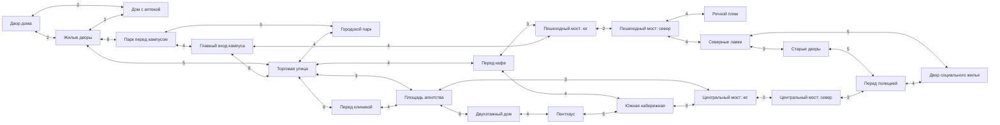

# Город EroInc: районы, сценарные места и маршруты

28 октября 2026. Статус: **проект переработки, не подключён к игре**.
Пользователь разрешил полностью переработать город при соответствии сценарию.
Текущие 15 меток больше не считаются пределом дизайна.

Машиночитаемая пара этого документа: `data/world/design/districts.json`.
Места и занятия развивает `PLACES_AND_LOOPS.md`, жителей и районные истории —
`RESIDENTS_AND_STORIES.md`. Новые имена районов и описанный ниже городской
граф являются предложениями. Они не добавляют задним числом фактов в сюжет.

## Источники и граница знания

Прочитаны локальные `TimeLine/timeline.dtl`, все содержательные `.dtl` в
`TimeLine/prolog/`, `TimeLine/chapter_one.dtl`, отдельный тестовый таймлайн
склада; `scripts/gameplay/guided_story.gd`, соответствующий поток в
`gameplay.gd` и `scripts/core/game.gd`; `scripts/managers/location_manager.gd`,
сцены `locations/` и `scenes/hub/WarehouseGateHub.tscn`; текущая география v2,
`city_layout.gd`, `city_world.gd`, определения мест базового и репродуктивного
runtime, расширения `presentation.gd`; локальные WORLD_HANDOFF, CITY_WORLD
и STORY_LOCKS. Файлы AppleDouble `._*`, пустой `TimeLine/prolog.dtl`, редакторские
и отладочные сцены не объявляются новыми местами мира.

Предоставленный пользователем Google Doc на этом этапе **не прочитан**.
STORY_LOCKS — локальная запись ранее закреплённых требований, а не заявление
о новой сверке с внешним документом. Окончательная сверка с доступным текстом
авторского сценария остаётся зависимостью. Интернет-источники не подменяют лор.

Обозначения: **факт** — явно указан в локальном сценарии/указании владельца;
**реализация** — только текущее техническое устройство; **предложение** —
авторское решение этого пакета; **не определено** — источник не даёт ответа.

## Почему нынешний мир выглядит скудным

1. **В одном имени смешаны экран и реальное место.** `global_map` — и сцена
   «Глобальная карта» в LocationManager, и южная торговая улица в v2, и место
   рынка, работы и ряда действий. Игроку трудно выучить адрес, если он называется
   функцией интерфейса. Предложение: карта остаётся экраном, улица получает
   собственное место `south_trade_street`; потребители меняются одновременно.
2. **Разные пространственные модели не составляют один город.** Есть отдельные
   сцены квартиры, восемь мест guided-story, 15 городских меток, мостовые узлы,
   runtime-`clinic` и `residential_district` без меток. Между двумя последними
   и бытовыми адресами нет общего читаемого плана. Предложение: одна иерархия
   «город → квартал → здание/двор → помещение», отдельная от экранов и эпох.
3. **Важные сценарные места отсутствуют как понятные адреса.** Дом с аптекой,
   соседи Асука/Оливер, актовый зал, мужской туалет и соседние аудитории уже
   существуют в тексте; карта/план кампуса почти не рассказывают, где они.
   Предложение: сначала дорисовать именно этот повседневный маршрут.
4. **Можно ошибочно склеить две страны и два дома.** В детстве герой гуляет
   у моря в Праксии и живёт на четвёртом этаже. Нынешний дом одноэтажный,
   университет находится в Эллизии. Подмена морской набережной нынешней рекой
   ломает не только фон, но и воспоминание. Пространственные слои разделены ниже.
5. **Маркер пока чаще сообщает функцию, чем характер места.** Южные места
   преимущественно «парк/кафе/магазины», северные лавки технически клонируют рынок
   с коэффициентом цены 0,9 (`city_layout.gd`). Нужны отличающиеся услуги,
   посетители, бытовые привычки и ограничения, а не только другой ценник.
6. **Сцены слабо объясняют повторный визит.** README v2 прямо описывает наружные
   виды как приближения одной карты и общий набор домашних комнат. Если разные
   места выглядят и используются одинаково, количество переходов не даёт глубины.
   Предложение: для первого района подготовить отдельные виды улицы/входов,
   малые события и возвращение к знакомым людям; полный город строить по той же логике.

Это недостатки связности и наполнения, а не утверждение об отсутствии уже
работающих профессий, NPC, календаря, жилья, погоды или отношений.

## Три пространственных слоя

| Слой | Подтверждено | Что нельзя переносить автоматически |
| --- | --- | --- |
| `present_ellizia` | Герой в зеркале называет возраст 23 и страну Эллизия; первый учебный день в институте; нынешний одноэтажный дом и река закреплены локально | Название нынешнего города, численность населения, история основания и связь с городом детства не названы |
| `childhood_praksia` | Герою около 12; парк, море, статуя Фемиды, Арка мира, Франкфуртский проспект, школа №40, общий с Лирой многоэтажный дом; парк связан с Праксией | Это не `student_home`, не нынешний `city_park` и не `north_beach`; Фраксия — страна прежнего проживания Лиры, не название этого города |
| `warehouse_frame` | Ночной заброшенный склад, ворота в отдельном Hub-сценарии, интерьер с проломанной крышей и последующее пробуждение | Время относительно основной игры и адрес склада не определены; пока нельзя привязать склад к северному кварталу как установленный факт |

Герой вспоминает фотографию, засыпая; флешбэк возвращается к будильнику первой
главы. Переход эпох — событие повествования, а не пешеходное ребро карты.
Общий визуальный мотив воды допустим, общая физическая география не доказана.

## Матрица всех локально описанных сценарных мест

`current_id` ниже обозначает фактическую текущую реализацию, а не всегда
отдельную комнату runtime. Имена с префиксом `fb_`/`frame_` — предлагаемые ID.

| Место и слой | Обязательный факт / переход | Текущая опора | Предлагаемая пространственная привязка |
| --- | --- | --- | --- |
| Склад снаружи, frame | Ночной фасад; ворота в отдельном Hub; точный адрес неизвестен | `prolog/prolog.dtl`; `testTimeline for game.dtl`; `WarehouseGateHub.tscn` | `frame_warehouse_exterior` → `frame_warehouse_interior`; не публичная метка нынешнего города |
| Склад внутри, frame | Старый зал, ящик, мусор/пыль, отверстие в крыше; потолок и рука — ракурсы, не комнаты | `scene_02_warehouse_confrontation`, `scene_03_death_reset` | Один интерьер с предметами и ракурсами; после него нарративный переход к спальне |
| Нынешняя спальня | Пробуждение 03:20 31 августа; кровать, часы, шкаф, фото | `bedroom`, stages `night`, `return_to_bed`, `photo` | `student_home` / `bedroom`; фотография не телепорт на карту |
| Нынешняя прихожая | Связь спальни с ванной/кухней и входом; неисправный свет | `apartment_hall` | Сохранить ID, убрать ошибочную внешнюю семантику «подъезд многоэтажки» |
| Нынешняя ванная | Раковина, зеркало и стиральная машина; мокрая подушка; `open_character_creator` только у зеркала | `bathroom`; scene05, guided goal `sink` | Сохранить `bathroom`; отражение и создание героя остаются здесь |
| Нынешняя кухня | Существует как доступная соседняя комната; чайник, окно, холодильник в guided-story | `kitchen` | Сохранить ID и связь через прихожую, не добавлять сюжетный обязательный завтрак |
| Двор/улица нынешнего дома | Одноэтажный дом с оградой; узкие студенческие улицы, дом оплачен родителями | `student_home`; guided `street`; chapter_one `arrival` | guided `street` привязать к фронту `student_home`, затем жилым дворам |
| Соседние дома | Асука живёт через четыре дома; реплика Оливера связывает её с домом с аптекой и соседним подъездом | chapter_one:223–225; отдельного адреса нет | `pharmacy_house` во дворах; отдельные двери соседей, без разрешения входить в квартиры |
| Парковая зона университета | Перед главным входом; по дороге виден краснокирпичный корпус | STORY_LOCKS; chapter_one:13 | `campus_park_gate` → `campus_courtyard`; это не автоматически городской парк с прудом |
| Университет снаружи | Центральное крыло 6 этажей, боковые по 3, три соединённых крыла | `university` map ID → runtime `training_center` | Контейнер `university`, фактическое прибытие `campus_courtyard`; название `training_center` заменить по смыслу вызова |
| Главный холл | Дежурный медведь; из холла актовый зал прямо | guided `campus_hall`; STORY_LOCKS | `campus_courtyard` ↔ `campus_hall` ↔ `campus_auditorium` |
| Актовый зал | Речь Михаила Мэтисона, затем расход по группам через 30 минут | Только текст chapter_one `arrival` | `campus_auditorium`, без прохода через учебную аудиторию |
| Коридор второго этажа левого крыла | Аудитория213 ближе к концу; на пути спортивная команда и косплейный клуб | `campus_corridor`, stage `campus` | Сохранить ID; связь с холлом через видимую лестницу/навигацию |
| Клубная зона | Лин, Мира, Уриил; Асука и косплейный клуб; вход в клубную комнату указан на бланке | chapter_one `club`; guided object `club` | Контакты в `campus_corridor`; `cosplay_clubroom` — существующая по тексту дверь, не автоматическое членство |
| Мужской туалет | Голоса и нападение на Оливера; близлежащий коридор и аудитории | chapter_one `oliver`; object `bathroom_door` | `campus_mens_washroom`, не домашний `bathroom` |
| Аудитория преподавателя / пустая аудитория | При выборе помощи налево есть преподаватель; направо поиск теряет время | chapter_one:104–118 | `campus_teacher_classroom` и `campus_empty_classroom` как две разные сюжетные точки на этаже |
| Аудитория213 | Второй этаж левого крыла; Райан Бредли, выбор дисциплин и секции | chapter_one `classroom`; в guided-story пока предмет, не комната | `classroom_213` внутри `university`; не общее помещение всех профессий и услуг города |
| Вечерняя дорога домой | Выход из института в18:00; Асука, при соответствующем выборе Оливер; соседние дома по пути | chapter_one `walk`/`questions`; stage `homecoming` | Обратный обычный путь через парковую зону и жилые дворы, не телепорт с кампуса к двери |
| Центральный парк детства | Аллеи со статуями/колоннами; главная площадь, дубы и пикники | scene06–08 | `fb_park_gate`, `fb_themis_square`, `fb_seaside_alley`; отдельный слой Праксии |
| Статуя Фемиды | Символ государства; встреча Томаса; сюда убегают с Лирой | scene06:8, scene11:2; scene13:5 | `fb_themis_square`; статуя — ориентир на площади, не отдельный город |
| Арка мира | Каменные своды между аллеей и морской набережной; по возвращении слышен плач в стороне | scene08:7–29 | `fb_peace_arch`; узел выбора между набережной, аллеей и зарослями |
| Морская набережная | Прибрежные кафе, автомат с колой, белые перила, вид на вновь открытый пляж | scene08 | `fb_sea_embankment`; автомат/перила — объекты, кафе видимы, герой не заходит внутрь |
| Пляж детства | Видим с набережной; открыли после прошлогоднего несчастного случая; посещение пока только планируется | scene08:19–20 | `fb_beach_view`; пометка referenced/view_only, не обязательный реально пройденный узел |
| Заросли возле арки | Мальчики/девочки травят Лиру; выбор помочь/уйти, бег к Фемиде | scene09–11 | `fb_park_thicket` ↔ площадь; не нынешние `north_alleys` |
| Поляна старого парка / часовня | Тихая поляна, маленькая часовня, камень, грунтовые дорожки; от площади5минут | scene11:27–31, scene12 | `fb_old_park_glade`, часовня как ориентир без придуманного входа внутрь |
| Франкфуртский проспект | Герой и Лира живут на нём; из парка идут к общему дому | scene11:15, scene13 | `fb_frankfurt_avenue`; у нынешних дворов не заимствовать адрес автоматически |
| Общий подъезд детства | Дверь по телефону; сломанный лифт; лестница с4-го на8-й этаж | scene13 | `fb_building_entrance` → `fb_floor4` → `fb_floor8`; лифт в этой сцене закрыт |
| Дверь Лиры | Восьмой этаж, отец Элиот выходит из квартиры; внутрь герой не заходит | scene14 | `fb_lyra_door`, без фантазий о плане чужой квартиры |
| Квартира семьи героя | Четвёртый этаж, кв72; мать, ванная, кухня, комната героя | scene13–15; `flashback_flee` | Отдельные `fb_family_hall`, `fb_family_bathroom`, `fb_family_kitchen`, `fb_family_bedroom` |
| Лестничная площадка с мусороприёмником | На один пролёт ниже квартиры, окно с закатом, возвращение ужинать | scene15 | `fb_half_landing`, не выход на нынешний двор |
| Школа№40 / Фраксия | Школа упоминается в речи героя; Фраксия — прежняя страна Лиры | scene11:15; scene12:40 | Referenced-only, без придуманного адреса/маршрута/доступа |

## Противоречия, которые нельзя молча превратить в канон

| Вопрос | Локальные источники | Решение этого пакета |
| --- | --- | --- |
| Название института | scene05: «университет Альтерра»; chapter_one/STORY_LOCKS: Институт эволюционной геномики имени Карла Линнея | На карте нейтральное «Университет»; варианты имён записаны как unresolved. Не изобретать название города «Альтерра» |
| Дом или квартира | Текст нынешнего пролога называет помещение квартирой; владелец явно закрепил одноэтажный отдельный дом | Снаружи одноэтажный дом; слово «квартира» в старых подписях — редакционная несогласованность, не второй этаж |
| Время первого сна | Пробуждение 31августа03:20, следующая глава 1сентября11:00 | Не исправлять даты за сценариста; на географию не переносить пропущенные сутки как путешествие |
| Откуда взялся склад на нынешней карте | Рамочный пролог не называет адрес и дату | Не добавлять обязательный городской путь к складу до сценарного решения |
| Один парк или несколько | Детский центральный парк у моря, нынешний парк у института, `city_park` с прудом | Три разные сущности до прямого подтверждения тождества; два нынешних зелёных пространства различимы |
| Шесть/три этажа против прежних фонов | Архитектура закреплена, guided-story использует условные/домашние фоны для ряда мест | Новые планы и будущие фоны подчиняются архитектуре; старые картинки не определяют план института |

## Предлагаемый нынешний город

Рабочая модель — компактный университетский город у реки в Эллизии, в котором
можно пройти обычные ежедневные дела пешком. Это **предложение масштаба**, не
подтверждённая численность населения. Не требуется придумывать столицу,
промышленную историю и государственную политику до авторской сверки.

Сюжет уже связывает геномику, людей/антро/смешанные линии, отношение к инаковости
и нейропротезирование. Поэтому быт должен отражать это спокойно: разная мебель
и проходы, совместные учебные/рабочие дела, профессиональная компетентность,
обычные неудобства. Не превращать весь город в фестиваль, карикатурную сегрегацию
или случайный неоновый киберпанк. Социальное напряжение проявляется через
конкретных людей и последствия, а не через вечные нападения на каждом перекрёстке.

| Предлагаемый район | Основные места | Характер и причина вернуться | Ритм и граница |
| --- | --- | --- | --- |
| Университетские дворы | `student_home`, `residential_district`, `pharmacy_house` | Небольшие дома, соседний многоквартирный дом с аптекой, знакомые лица; дом не единственная точка быта | Утренние сборы, вечерние возвращения; чужое жильё всегда частное |
| Кампус за парком | `campus_park_gate`, `campus_courtyard`, контейнер `university` с помещениями | Шестьэтажная центральная башня/крыло и два крыла по3этажа, большой парк перед входом, реальные учебные/клубные адреса | До главного входа из двора дома14минут; занятия и двери живут по расписанию |
| Южная торговая улица и река | `south_trade_street`, `city_park`, кафе, набережная, агентство, клиника | Повседневные покупки, еда, работа и услуги; отдельный городской парк и прогулка у воды | Днём дела и смены, вечером встречи; улица не закрывается вслед за магазином |
| Восточные жилые террасы | `detached_house`, `penthouse`, прилегающая часть набережной | Жильё с разной ценой и устройством, планы на переезд, обычный уход за домом | Покупка/аренда дают адрес, а не право входить в соседние владения |
| Старый северный берег | `north_shops`, `north_alleys`, `north_beach`, `north_den`, полиция и социальное жильё | Ремонт, недорогие услуги, дворы и реальный доступ к воде; сложное заведение — лишь одна точка района | Утро работа, день покупки/уход, вечер отдых; социальное жильё не метка «опасные люди» |

Два моста сохраняются как понятные обходы. Пешеходный удобен для кампуса,
кафе, пляжа и лавок; центральный — для агентства, северных общественных служб
и восточного жилья. Ни один берег не требует покупать транспорт для обычной жизни.

### Предлагаемый граф наружных маршрутов

Числа ниже — **предлагаемые минуты пешком**, кроме ограничения дом→институт
10–15минут. Полный список рёбер и помещений находится в JSON. Все уличные
рёбра двусторонние; часы работы проверяются у входа в помещение, а не на
сквозном тротуаре. Не прокладывать ночной путь через закрытую кассу кафе.

Наружные узлы `riverside_cafe_front`, `clinic_forecourt`, `agency_square`,
`police_forecourt` отделяют проход и ожидание от действий внутри здания.
Существующие ID кафе/клиники/агентства/полиции можно сохранить для соответствующих
помещений. На карте они остаются одним понятным зданием, а не двумя соседними
дублирующими метками. Зайти внутрь — отдельное контекстное действие.

### Помещения кампуса и дома

Дом: `student_home` ↔ `apartment_hall` ↔ `bedroom` / `bathroom` / `kitchen`.
Один надземный этаж, никаких лестниц наверх. Размещение дверей должно быть
одинаковым ночью, утром и после возвращения. Зеркало, фото и шкаф остаются
в своих комнатах. Перемена жилья меняет адрес инстанса комнат, а не превращает
чужую спальню в общедоступное место.

Кампус: `campus_courtyard` ↔ `campus_hall` ↔ `campus_auditorium` прямо;
из холла лестница ведёт в `campus_corridor` второго этажа левого крыла.
От коридора — `classroom_213`, `campus_mens_washroom`, дверь `cosplay_clubroom`
и две отдельные аудитории выбора помощи. Сначала виден путь/табличка, затем
действие. Не нужно рисовать каждый из шести этажей для первого игрового этапа,
но остальные этажи не исчезают из архитектуры.

### Предлагаемая планировка первого набора

Стороны света в этом плане — предложение, не сведения сценария. Сохраняются
все обязательные комнаты, предметы и отношения «прямо / этаж / крыло».

**Одноэтажный дом.** Улица и калитка с юга; за входом центральная прихожая.
Слева спальня, справа ванная, дальше справа кухня. В спальне одним ракурсом
читаются кровать, тумбочка с фото и шкаф. В ванной зеркало расположено над
умывальником, а стиральная машина стоит сбоку и не закрывает отражение.
Ночной путь «спальня → прихожая → ванная → прихожая → спальня» совпадает
с обычным дневным путём. Внешний узел дома обозначает подход перед частной
калиткой; чужие прохожие не получают доступ во двор и комнаты. Дом с аптекой
имеет короткую соседскую ветвь в две предложенные минуты мимо четырёх домов,
без прохода через частные участки.

**Первый этаж кампуса.** Из большого парка через двор виден главный вход.
Вход ведёт в холл; актовый зал расположен прямо по его оси. Лестница слева
поднимается в коридор второго этажа левого крыла. Выход из зала снова в холл,
а не сразу в аудиторию 213. Фасад сохраняет силуэт 6/3/3 даже при первом
этапе, в котором доступны лишь необходимые помещения.

**Второй этаж левого крыла.** Лестница приходит с восточной стороны коридора;
213 находится ближе к его дальнему западному концу. Клубная дверь ближе
к началу, мужской туалет — в средней части с южной стороны. Выходящий из
туалета смотрит на север: налево по коридору находится аудитория с
преподавателем, направо — аудитория, в которой в этой сцене преподавателя
нет. Так сюжетный выбор помощи имеет буквальное пространственное объяснение.
Это не значит, что правая аудитория пуста во все остальные дни.

Текущий `guided_travel` не расходует игровые минуты; время сцены выставляется
сигналами отдельно. Предложенные минуты нового графа нельзя автоматически
прибавлять поверх сценарного пути второй раз. Детский флешбэк не запускает
нынешний календарь/старение NPC. Подробные связи и принадлежность помещений
записаны в `interior_plans` и `story_runtime_boundary` JSON.

## Три повседневные петли

| Петля | Маршрут по предложенному графу | Что чередуется | Повод вернуться |
| --- | --- | --- | --- |
| Учебный день | Дом→дворы→парковый вход→кампус; после занятий кампус→торговая улица→дворы→дом |14минут к кампусу; занятие/группа;8минут к покупкам;7минут домой | Учебный план, знакомые соседи, продукты, дела клуба; не каждый день один и тот же обязательный эпизод |
| Работающий взрослый | Дом→дворы→торговая улица→кафе; после смены парк либо прямо домой |11минут до фронта кафе плюс вход; смена, еда, отдых; запас времени до следующих дел | Реальная вакансия и смена, покупка нужных вещей, короткий разговор; можно отказаться от прогулки |
| Северные дела и прогулка | Дом→торговая улица→кафе→пешеходный мост→лавки; назад через двор полиции и центральный мост |20минут до лавок по уличным рёбрам, ремонт/покупка, новый вид воды и другой обратный путь | Ремонт и заказ, доступная услуга; пляж как спокойная боковая ветвь, не обязательный риск |

В JSON отдельно указаны реальные нынешние рёбра v2 и предлагаемые новые.
Приведённые выше минуты не описывают уже изменённый runtime.

## Первый час свободной игры

Отсчёт — от выхода в свой двор; создание героя/сюжетное прибытие не ускоряются.
В обычный учебный день ближайшая пара имеет приоритет: игрок видит короткий
маршрут на кампус и может пропустить знакомство с кварталом.

Предлагаемый спокойный час без скорой пары/смены: двор дома→жилые дворы (2),
осмотр ориентиров/контактов (5), торговая улица (5), покупка/планирование (8),
кафе снаружи (4), короткое добровольное знакомство или отдых (10), городской
парк через торговую улицу (8), пауза/заметка о собственном плане (7), домой
через торговую улицу и дворы (11). Всего60минут;30 из них — ходьба,
30 — предложенные занятия. Чтение карты и простое открытие описания не тратят
время. При отказе от знакомства маршрут остаётся проходимым и сокращается.

Числа занятий — предложения для темпа, не переопределение текущих команд.
Соседство показывается через видимую аптеку/двор, но встреча с Асукой/Оливером
не гарантируется: режим песочницы не обязан создавать сюжетный состав.

## Первый связанный набор для внедрения

**Университетские дворы + торговая улица + вход кафе.** Обязательное ядро:
одинаковый дом/двери во всех сюжетных состояниях; реальный адрес аптеки и
соседних домов;14-минутный путь через парк к институту; короткая бытовая ветвь
на покупки и кафе. Внутренний кампус доводится до первого этажа и левого крыла
с213, актовым залом и туалетом. Север и новое жильё сохраняют рабочие входы,
но не требуют немедленно рисовать десятки финальных фонов.

Пакет для первого внедрения должен соединить три результата: этот граф,
карточки предметов/мест от автора мест и одну районную цепочку от автора
жителей. Нельзя внедрить только новые подписи и объявить мир насыщенным.

### Жильё первой пары новых жителей

Для физической автономии Селины и Даны предусмотрены два частных логических
адреса: `city_resident_home_selina` и `city_resident_home_dana`, каждый в двух
предложенных минутах от `residential_district`. Это отдельные offscreen-единицы
жилья без меток карты, не спальня игрока и не дома Асуки/Оливера. Публичный
район нельзя объявить общей частной спальней всех жителей.

Владелец-NPC может пройти домой; игрок по умолчанию доступа не имеет.
Условие приватности проверяется относительно действующего персонажа, чтобы
запрет игроку случайно не блокировал автономный путь самого жильца. Эти
адреса добавлены по контракту автора жителей как предложение для будущего
первого набора; сейчас в runtime они не зарегистрированы.

## Утро, день, вечер, ночь и погода

- Утром силуэт института виден за парком; в жилых дворах слышны сборы и
  обычные бытовые дела. Днём торговая улица связана с покупками и сменами.
- Вечером путь из института ведёт к знакомым адресам и свету кафе; ночью
  остаются читаемые публичные пути и домашние входы. Работающий свет не
  означает, что чужая квартира или заведение открыты.
- Дождь меняет места встреч и использование навеса; не должен мгновенно
  отменять все прогулки или добавлять несуществующий общественный транспорт.
  В снег сохраняется обычный доступ по известным путям, пока отдельная система
  покрытий/сезонов не спроектирована и не подключена.
- Сезонные лужи, снеговые сугробы и исторические версии зданий — будущие
  художественные задачи, не заявление о нынешней симуляции. Детское лето не
  получает текущую погоду сентября из игрового календаря.

## Как переходить от дизайна к данным

1. Сверить авторский внешний сценарий, когда доступен его текст; решить имя
   института и место рамочного склада. Это не мешает проектировать подтверждённые
   комнаты и районные услуги сейчас.
2. Утвердить конкретный первый граф. `global_map` заменить на реальную улицу;
   `training_center` разнести по назначению: двор кампуса, учебное помещение,
   рабочее место. Это список замен вызовов, **не** слой совместимости.
3. Менять основной каталог, guided-места, NPC-маршруты, занятия, работу,
   карту и сохранение состояния одним согласованным этапом. Не сохранять
   старую параллельную географию. Пользовательские слоты не переписывать.
4. После распределения владения внедрить улицу/входы и предметные действия
   вместе с районной историей; затем готовить финальные планы и фоны.

Следующий подготовленный этап описан в [GRAPH_INTEGRATION.md](GRAPH_INTEGRATION.md):
`data/world/city-graph.json` и `scripts/gameplay/city_graph.gd` содержат расширенный
нынешний каркас, адреса действующих назначений и actor-aware доступ. Он ещё
не подключён. Этот первоначальный дизайн и его JSON не используются модулем
как запасная карта.

Тестовые запуски и Git-операции в этом дизайн-этапе не выполнялись.
