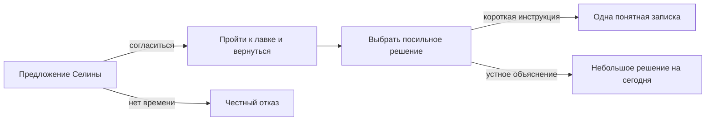

# Жители и районные истории

28 октября 2026. **Авторская проработка, ещё не подключённая к игре.**
Данные: `data/world/design/neighborhood_stories.json`. Новые жители, имена,
бытовые детали, расписания и последствия ниже — предложения для EroInc,
а не утверждение об уже существующем каноне или готовом runtime.

## Что мешает ощущению живого места

- `npc_stories.gd::arc_for()` выдаёт случайным NPC одну из трёх общих цепочек
  по hash ID. У людей разные параметры, но мало различимых собственных забот.
- Связь личной истории с местом часто сводится к посещению метки. Для нового
  набора важны конкретная дверь, стойка, видимый предмет и сосед по работе.
- У существующих шести историй есть концовки, память и однократные награды.
  Однако для новых жителей ещё нет авторских реакций при следующем визите.
- При расширении легко получить население из одних просителей. Поэтому трое
  из семи предложенных жителей не начинают собственные квесты в первом наборе;
  у каждого есть дела и границы, не зависящие от согласия героя.
- В сюжете важны уязвимость, отчуждение, помощь без унижения и принадлежность.
  Уютный район не должен стирать эти темы или превращать их в обязательную
  моральную викторину с единственным правильным ответом.

## Сценарные границы

Проверены местные `TimeLine/prolog/scene_04_night_wakeup.dtl`,
`scene_05_mirror_and_photo.dtl`, `scene_06_flashback_park.dtl`,
`scene_12_glade_reveal.dtl`, `TimeLine/chapter_one.dtl` и
`docs/art/city-river-v2/STORY_LOCKS.md`.

Герою настоящего времени 23 года; создание остаётся отражением у домашнего
зеркала. Одноэтажный нынешний дом не подменяется квартирой детского воспоминания.
Детский парк связан с Праксией, упоминание Фраксии относится к происхождению
Лиры, нынешнее обучение — к Эллизии. Море воспоминания не превращается в реку
текущей городской карты. Новые жители не знают тайну кошмара героя автоматически.

Имя «Мира» уже занято сценой клуба в первой главе: старшая смены нового кафе
названа **Селиной**. Асука живёт через четыре дома; Оливер упоминает соседний
подъезд дома с аптекой. Новые жильцы не получают эти квартиры по умолчанию.
Город пока не назван: «Альтерра» в зеркальном монологе названа университетом,
тогда как первая глава и STORY_LOCKS дают Институт эволюционной геномики
имени Карла Линнея. Этот конфликт нельзя исправить выдуманным названием города.

Пользователь разрешил переработку географии под сценарий. Поэтому у контента
есть смысловые `place_anchors`; текущие `runtime_id` — только исходные привязки.
Число нынешних меток не ограничивает следующий план города. Внешний авторский
Google Doc этим исполнителем не прочитан; окончательная сверка с ним остаётся
зависимостью. Локальные таймлайны не выдаются за новую копию внешнего документа.

Сверка с `DISTRICTS_AND_ROUTES.md` добавлена в данные как
`intended_location_id`: торговая улица — `south_trade_street`, зал кафе —
`riverside_cafe`, наружный вход — `riverside_cafe_front`, старые лавки —
`north_shops`, городской парк — `city_park`, парк перед университетом —
`campus_park_gate`. `university` — контейнер здания, не готовая аудитория
для расписания Нины. `social_housing` не открывает частные помещения.

## Семь жителей одного города

Все семеро — совершеннолетние оригинальные предложения. Вид, внешность,
частный дом и окончательная профессия назначаются после сверки сценария,
каталога населения и карьер. Не создавать семь копий спальни героя и не
заказывать для них новый арт до стабилизации утверждённого стиля.

| Житель | Где его узнать | Своя забота и противоречие | Что остаётся без участия игрока |
| --- | --- | --- | --- |
| Селина Вейл, 29 | Кафе, боковая дверь и стойка | Хочет уходить вовремя; сама усложняет инструкции | Передаёт смену, исправляет собственные записки, встречает Дану |
| Дана Керн, 41 | Продуктовая лавка торговой улицы | Замечает чужую усталость, отрицает свою | Принимает товар, передаёт кассу на перерыв, иногда пьёт чай после работы |
| Илья Рен, 34 | Стойка ремонта в старых лавках | Знает цену времени, хранит невыгодную старую вещь | Выполняет заказы и сам решает судьбу лампы |
| Нина Арден, 27 | Университет, кафе, вечерний парк | Призывает отдыхать, заполняет работой собственные окна | Посещает выбранные занятия, работает по согласованным часам, учится отдыхать |
| Павел Сорн, 56 | Городской парк, отдельно от университетского | Не любит запреты, но начинает с них, когда не слышат | Работает утром; вечером приходит посетителем, а не владельцем парка |
| Рая Фенн, 32 | Подход к социальному жилью и старые лавки | Устала всё организовывать, но организует чужой отдых | Работает, собирает часть бытовых просьб, может пропустить соседскую встречу |
| Лев Терн, 23 | Пляж и старые лавки | Хочет постоянной работы, боится казаться несерьёзным | Закрывает работу по погоде, узнаёт реальные требования зимнего заработка |

Расписания в JSON — окна дизайна, не готовые брони календаря. До интеграции
нужны дорога между работой и отдыхом, часы открытия и индивидуальные исключения.
При занятости человек недоступен; он не появляется в месте только потому,
что герой открыл его историю. Внутренние помещения социального жилья не
становятся публичными от одного знакомства с Раей.

### Связи без обязательного квеста

Селина и Дана делят один проход: ящик лавки скрывает указатель кафе, а объяснять
путь приходится продавцу. Нина покупает в кафе один заказ и иногда мешает
закрытию, задерживаясь с заметками. Илья знаком с Даной по работе, но не обещает
принимать её заказы без очереди. Лев узнаёт у него требования зимнего заработка;
один разговор не выдаёт профессию и должность. Павел и Нина могут просто сидеть
рядом молча. Рая учится спрашивать о помощи, а не считать свободное время Льва
общим ресурсом. Все эти отношения предложены, а не записаны в действующий World.

В обычной сцене достаточно одного наблюдения или короткого приветствия.
Полосы отношений и длинная биография не должны открываться при каждом входе.
Например: Дана освобождает проход от ящика; Илья подвигает свою лампу;
Нина закрывает заметки вместо нового разговора о продуктивности.

## Три оригинальные цепочки

Каждая содержит шесть узлов: добровольное предложение → одно настоящее
действие → выбор → две разные концовки и отдельное завершение при отказе.
При завершении назначена одна маленькая награда опытом и отношением;
денег, бесплатных вещей, штрафа за отказ и наград за повторный визит нет.
Числа — предложенный баланс. Текст и граф отделены строковыми ключами.

### 1. Дверь со двора — Селина

Две записки кафе отправляют прохожего к разным дверям. Селина просит посмотреть
на путь со стороны торговой улицы, только если герою по дороге. Он действительно
проходит `riverside_cafe → global_map → riverside_cafe`; карта сама по себе
цель не закрывает. Это не новая функция свободного осмотра.

После возвращения можно вместе сократить инструкцию до направления и времени
либо пока оставить устное объяснение посетителям. Селина исправляет собственное
объявление; герой не становится начальником кафе. При отказе она после смены
сама проходит к лавке. Никакого автоматического долга «помочь позже».

Первая законченная петля для уже знакомого доступного NPC: **22 игровых минуты**
по исходному графу — 4 на предложение, 8 на дорогу и 10 на большое решение.
Покупка не требуется. Время начального знакомства и дороги к кафе сюда не
включено; запуск новой игры не гарантирует уже достигнутое доверие. После
перепланировки города маршрут пересчитывается, число 22 не становится каноном.

В новом графе это наружный маршрут `riverside_cafe_front → south_trade_street →
riverside_cafe_front`. Селина сама выходит проверить записки в реальное окно
после смены. Для такого разговора не нужно покупать вход в зал или проходить
ночью через закрытую кассу. Данные содержат старую цель только как справку
об имеющемся контракте; предполагаемая новая цель указана отдельно и не
служит совместимым запасным путём runtime.

### 2. Вещь, которую не выбрасывают — Илья

Мастер откладывает собственную старую лампу, хотя чинит чужие вещи каждый день.
Игрок может предложить обычную практическую помощь именно ему. Нужен принятый
`npc_relationships.interact/cooperate`; помощь другому человеку и отказ NPC
не закрывают цель. Герой лишь сверяет список и раскладывает подписанные детали;
квалифицированную работу выполняет сам мастер.

Выбор: сохранить работающую вещь со следом времени либо корпус на память,
использовав остальные детали в другом деле. Ни одной концовкой игрок не получает
лампу, профессию ремонтника или возможность чинить любую вещь. При возвращении
виден результат решения Ильи — освещённый край стойки или знакомый корпус на полке.

### 3. Место, где можно ничего не делать — Павел

У скамьи появляется ненужное расписание посещений. Павел предлагает сначала
самому отдохнуть в парке и увидеть, как им пользуются разные люди. Цель —
реальное `needs.leisure` в `city_park`: по текущему коду это **30 минут**.
Эта цепочка не выдаётся за короткое пятиминутное событие первой прогулки.

После отдыха можно предложить знакомым небольшой тихий промежуток без брони
либо вообще убрать расписание и договариваться на месте. Оба решения сохраняют
доступ к общественному пространству. Ни Павел, ни герой не получают права
запретить посетителям приходить. Если Павел ушёл, итог обсуждается при следующем
реальном пересечении расписаний. Игрок не запирает его в сцене на полчаса.

## Продолжение первого эпизода: конкретный handoff

В первом подключаемом наборе достаточно Селины, роли Даны и маршрута между
двумя местами. Остальные жители могут появиться позднее; не нужно сразу
перестраивать всё население.

| Ситуация | Наблюдение/реакция | Ограничение |
| --- | --- | --- |
| Первое посещение без контакта | Две несогласованные записки; короткое приветствие Селины | История не стартует сама, доверие не начисляется за чтение |
| Знакомый герой, спокойная передача смены | Добровольное предложение с ясной ценой времени | Сохраняется обычная проверка присутствия и занятости |
| Смена перегружена | «Сейчас не успею объяснить. После передачи смены можно будет поговорить» | Не отменять профессиональную задачу ради предложения |
| Герой ушёл и вернулся поздно | Цель пути остаётся выполненной; разговор доступен в следующее окно | Не проваливать сюжет скрытым дедлайном |
| Дождь | Бумага сушится под навесом; путь считается по настоящей погоде | Не телепортировать героев и не обещать бесплатную защиту от погоды |
| Есть другой незаконченный шаг этой истории | Короткое напоминание об уже принятом решении | Не дублировать историю/награду |
| Короткая инструкция выбрана | При следующем визите виден свободный проход и одна стрелка | Показывать изменение после завершения, не при предпросмотре выбора |
| Выбрано устное решение | Селина сама направляет посетителя, записка остаётся её делом | Не превращать скромный исход в «неправильный» |
| Игрок отказался | Обычные покупки и общение доступны; Селина занимается вопросом сама | Отказ окончателен для этой версии арки, без повторного давления |

Короткие продолжения уже записаны в `strings_ru`. Появление Даны в кадре
проверяет её фактическое расписание. Если она отсутствует, показывать только
предметное изменение прохода, не реплику невидимого персонажа.

## Что уже умеет код и что нужно подключить

| Контракт | Состояние по исходникам | Требуемое действие при интеграции |
| --- | --- | --- |
| Ветвление, стоимость выбора, окончание | Действующий `npc_stories` | Адаптировать наши `text_key`/`minutes_proposal` в текущий формат |
| Наблюдение за успешным переходом, помощью, досугом | Поддерживаются `goal` и фильтры location/target | Использовать эти цели без ручной кнопки «засчитать» |
| Явная личная арка нового NPC | Сейчас известное имя либо hash в тройку шаблонов | Добавить явное соответствие через текущий каталог; не новый runner |
| Знакомство, доверие, занятость | `blocked()` требует контакт и trust ≥ 5 | Для первого набора учитывать время знакомства; иной порог требует решения координатора |
| Флаги предметных последствий и реакций следующего визита | Наша проработка; не встроенный контракт данного файла | Сохранить через существующую память/транзакции и авторские записи |
| Фоновые решения жителей при отказе | Только авторское намерение | Согласовать с автономией; не выдавать NPC награды или мгновенные вещи |
| Время/погода/местные доступности | Действующие системы мира | Перепривязать к утверждённой новой географии |
| Частные дома новых жителей | Не назначены | Сначала определить реальные места, не использовать спальню игрока |

`neighborhood_stories.json` намеренно не повторяет каталог runtime и не должен
подключаться как `npc_stories.json`. Здесь нет нового языка сценариев или
параллельной симуляции: это локализуемый граф и описание будущей адаптации.

## Фактическая проверка этого этапа

Прочитаны локальные данные, код целей и сценарные фрагменты. Сверены ручные
ветви трёх графов и факт получасового досуга. Игра, тесты, Git и пользовательские
сохранения не запускались и не изменялись. Подключение, визуальная компоновка,
реальная доступность NPC и баланс ещё не проверены в игре.
